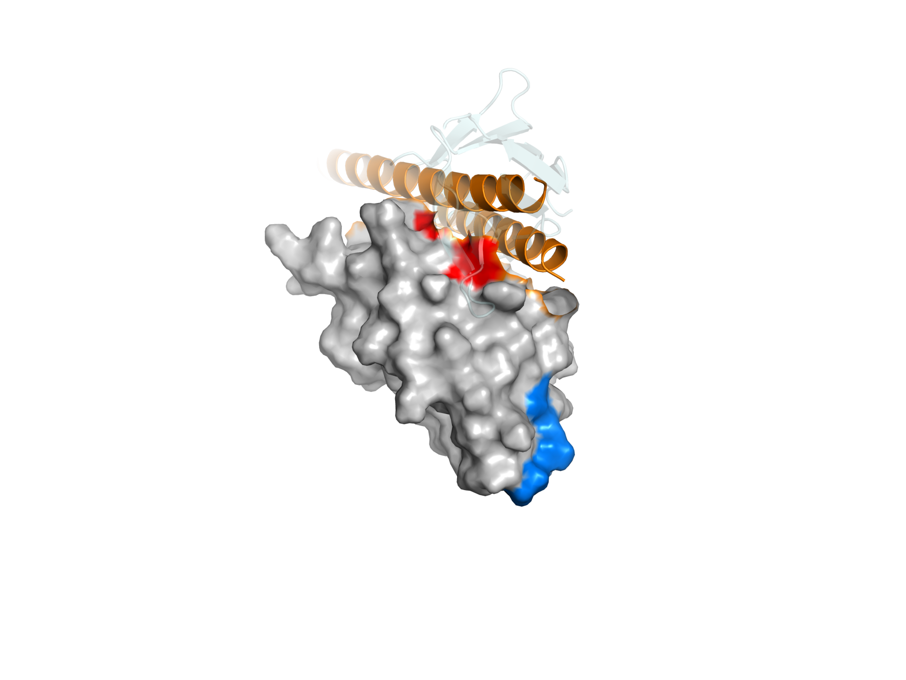
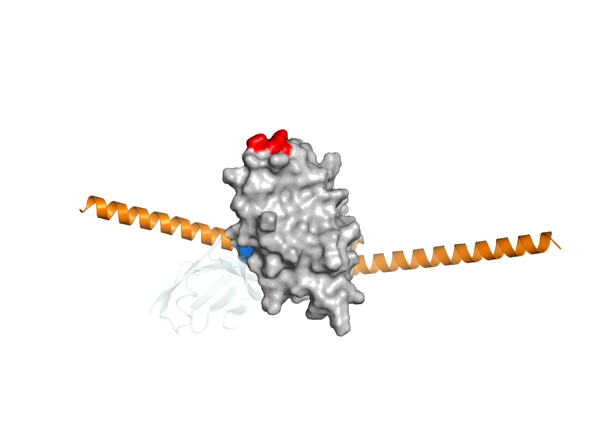

# PD-L1 de novo binder design — does naming the hotspots change the outcome?

[한국어](README.md) | **English**

> This is a condensed summary. The Korean [`README.md`](README.md) is the
> source document and carries the full method, every limitation, and the
> record of what went wrong along the way. Code, CSVs and figures are
> language-neutral and are the same for both.

I designed new proteins to bind PD-L1, a target used in cancer immunotherapy.
There is one question behind the work: **if you tell a generative model to aim
at a particular patch on the surface, does anything change?**

To answer it I needed a control. For every design aimed at the real binding
site I made a matched design aimed at a different patch on the same protein,
and compared the two batches.

---

## Hypotheses and results

All criteria were written down in [`preregistration.md`](preregistration.md)
before anything was run.

| Hypothesis | Question | Measured on | Criterion | Result |
|---|---|---|---|---|
| **H2a** | Did the binder land on the named patch? | backbones as RFdiffusion produced them | CA–CA 8 Å, ≥2 of the 4 named residues | 76% vs 82% = **0.93×**, fails |
| **H2b** | Same question | complexes re-predicted by ProteinMPNN + AF2 | heavy-atom 4.5 Å, same ≥2 rule | 48% vs 4% = **12.0×**, passes |
| **H1** | Is the interface any good? | same re-predicted complexes | median `dG_separated` | −1.77 vs −0.01 REU, inside the ±1.7 precision, unreadable |

H2a and H2b ask the same question of two different structures. Both were
pre-registered. Heavy-atom 4.5 Å was the original criterion; RFdiffusion
output has no side chains, so CA–CA 8 Å was added as the backbone-only
substitute and the original was kept for "once side chains exist".

---

## The three findings

**1. Hotspot targeting works, but the generator's own output cannot show it.**

RFdiffusion puts the binder on whichever patch you name, and it does so
equally well for both patches (76% and 82%). The difference only appears
after an independent model re-predicts the complex: 12.0× on the
pre-registered heavy-atom criterion.

**2. Interface quality points the same way, though the pre-registered
statistic cannot see it.**

The median difference is 1.76 REU against a measurement precision of
±1.7 REU, so it is not readable, and that is reported as-is. The
distributions are not close:

| | epitope | control |
|---|---|---|
| designs that formed an interface (`dSASA_int` > 500 Ų) | **24/50** | **1/50** |
| `dG_separated` < −10 REU | 17/50 | 1/50 |
| best `dG_separated` | −37.04 REU | −20.25 REU |

**3. Position, size and energy point at the same designs.**

The eight best designs by energy are all from the epitope group, all contact
all four named residues, and all pass H2b. The one control design with good
energy, `pdl1_ctrl_12`, contacts **none** of its four named residues. It
built a reasonable interface somewhere else.

| hotspots contacted | designs | median `dG_separated` |
|---|---|---|
| 0 | 26 | −0.30 REU |
| 2 | 3 | +1.11 REU |
| 3 | 5 | −12.45 REU |
| **4** | **16** | **−19.91 REU** |

---

## Figures

<table>
<tr>
<td width="50%"></td>
<td width="50%"></td>
</tr>
<tr>
<td><b>Best epitope design</b><br>
<code>dG_separated</code> −37.04 REU · 4/4 hotspots · H2b passes</td>
<td><b>Best control design</b><br>
<code>dG_separated</code> −20.25 REU · <b>0/4</b> hotspots · H2b fails</td>
</tr>
</table>

Grey is the PD-L1 surface, orange is the designed binder, pale cyan is native
PD-1. Red marks the four epitope hotspots, blue the four control hotspots.
Both panels use the same scale and place the target in the same position, so
the only thing that differs is where the binder sits.

Figures are generated from the data by
[`scripts/07_render.py`](scripts/07_render.py); the `.pml` files it writes are
committed so the camera and selections can be checked.

---

## Design

| | epitope group | control group |
|---|---|---|
| hotspots | A56 Tyr, A115 Met, A121 Ala, A123 Tyr | A32 Tyr, A106 Leu, A109 Ala, A132 Ala |
| what it is | the PD-1 binding site | a non-epitope surface |
| hydrophobic | 4/4 | 4/4 |
| aromatic | 2 | 1 |
| backbones | 50 | 50 |

The control is the point of the experiment. A binder can land on a patch by
chance, and without ruling that out "I named it and it went there" means
nothing. Hydrophobicity was matched 4/4 so that a control failure could not
be explained by "polar surfaces are harder to bind". Aromatic count could not
be matched, and that is recorded as a limitation.

Target is PD-L1 chain A of PDB **4ZQK** (residues 18–132). Backbones were
generated with RFdiffusion (T=50, binder 70–100 aa), sequences with
ProteinMPNN, complexes re-predicted with AF2 initial guess, and interfaces
scored with PyRosetta.

---

## What this work does not claim

1. **No experimental validation.** Everything here is in silico.
2. **Binding is not demonstrated.** `dG_separated` is a computed score in
   Rosetta Energy Units, not an affinity, and its absolute value cannot be
   read as one.
3. **n = 50 per group.** The RFdiffusion paper generates thousands. At this
   size the claim is about the difference between two batches, not about
   having found a good binder.
4. **The two patches are not perfectly matched.** Aromatic residues are 2
   against 1, so a wider interface in the epitope group could come from the
   extra aromatic rather than from the epitope itself.
5. **`pae_interaction` is uncalibrated here.** Its positive control, native
   PD-1, scored 26.06 and failed, so the metric was reported as a measurement
   failure and `dG_separated` was promoted in its place, exactly as the
   pre-registration specified for that case.
6. **The pre-registration chose a statistic that cannot see the result.** It
   asked for a median comparison, but the difference between the groups lives
   in the tail. The median is reported anyway and the tail statistics are
   labelled post hoc throughout.
7. **The three axes are not independent.** Hotspot contacts, interface area
   and interface energy are all computed from the same AF2 structure.

The Korean README lists twenty limitations with the reasoning behind each.

---

## Reproducing

```bash
git clone https://github.com/OHfromH2O/pdl1-rfdiffusion-hotspots
cd pdl1-rfdiffusion-hotspots

python scripts/07_render.py                      # figures
python scripts/h1_join.py --csv h1_rosetta.csv \
    --sc outputs/h1_af2/epi_af2.sc outputs/h1_af2/ctrl_af2.sc \
    --out h1_joined.csv                          # joined metrics
python scripts/h2_hotspot_contacts.py --compare --out h2_contacts.csv
```

Every number in the tables above comes from a committed CSV. The GPU stages
(RFdiffusion, then ProteinMPNN and AF2) are reproducible from the committed
backbones with [`notebooks/H1_dl_binder_design.ipynb`](notebooks/H1_dl_binder_design.ipynb);
see [`outputs/README.md`](outputs/README.md) for what is and is not committed.

PyRosetta and PyMOL do not run on native Windows. Use WSL2 or Linux.

---

## Licence notice

Code and documents in this repository are mine. External tools keep their own
licences: RFdiffusion (BSD), ProteinMPNN (MIT), dl_binder_design (MIT),
AlphaFold2 code (Apache 2.0) and parameters (CC BY 4.0), structure 4ZQK from
the RCSB PDB.

**PyRosetta needs its own licence.** It is free for academics but you have to
obtain it yourself; mine does not transfer to readers. The results of those
stages are committed as CSVs, so the numbers can be checked without it.
