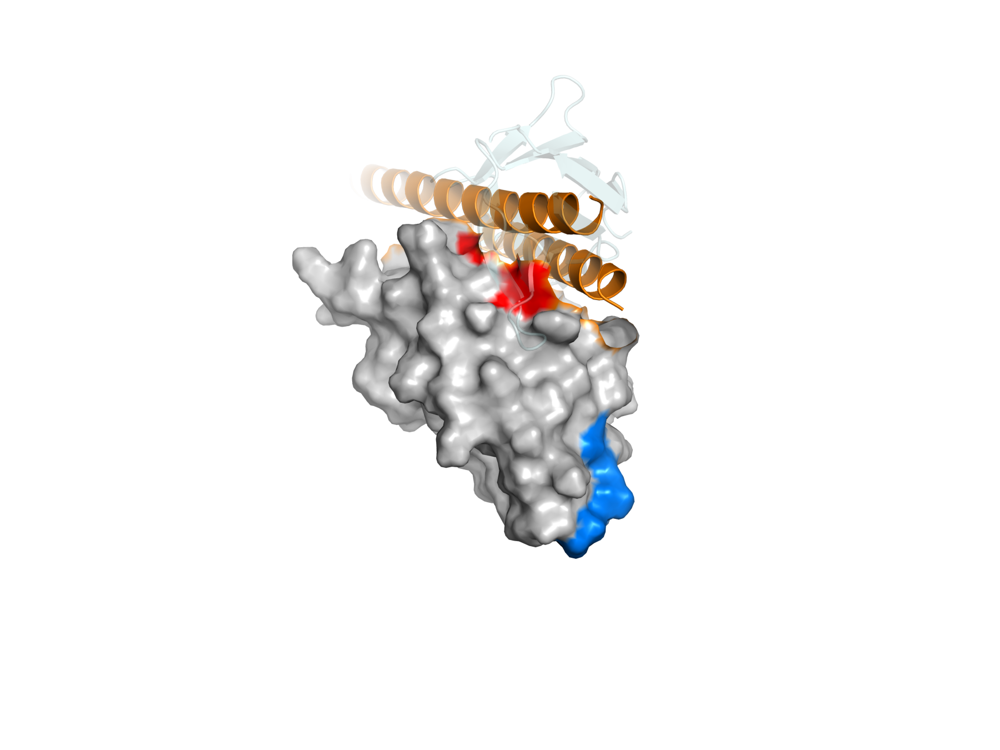
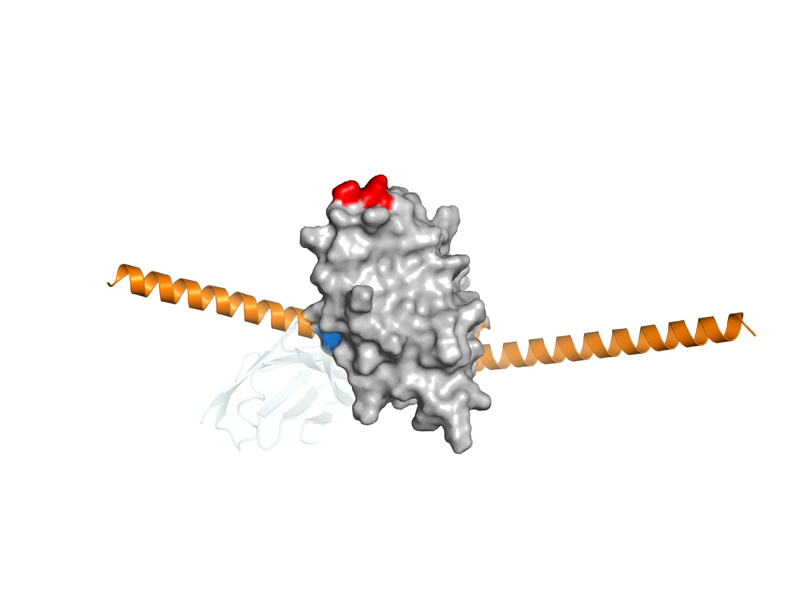
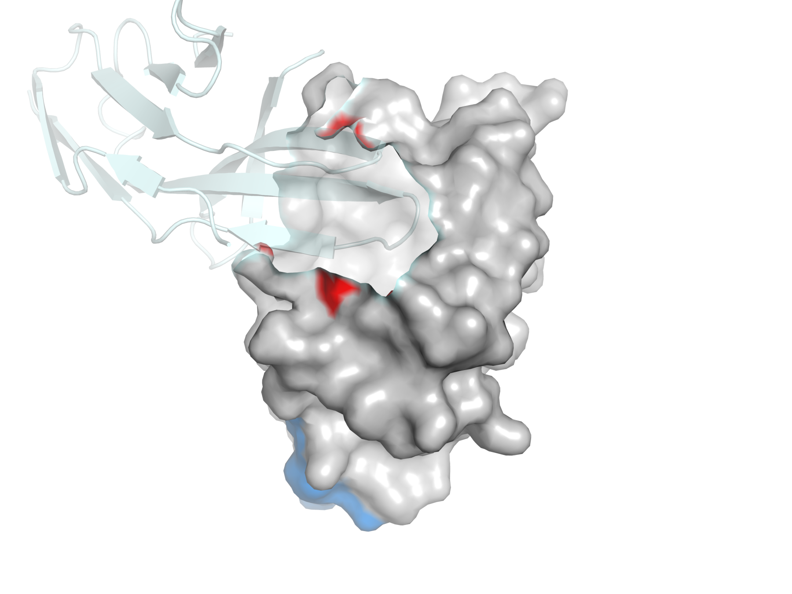
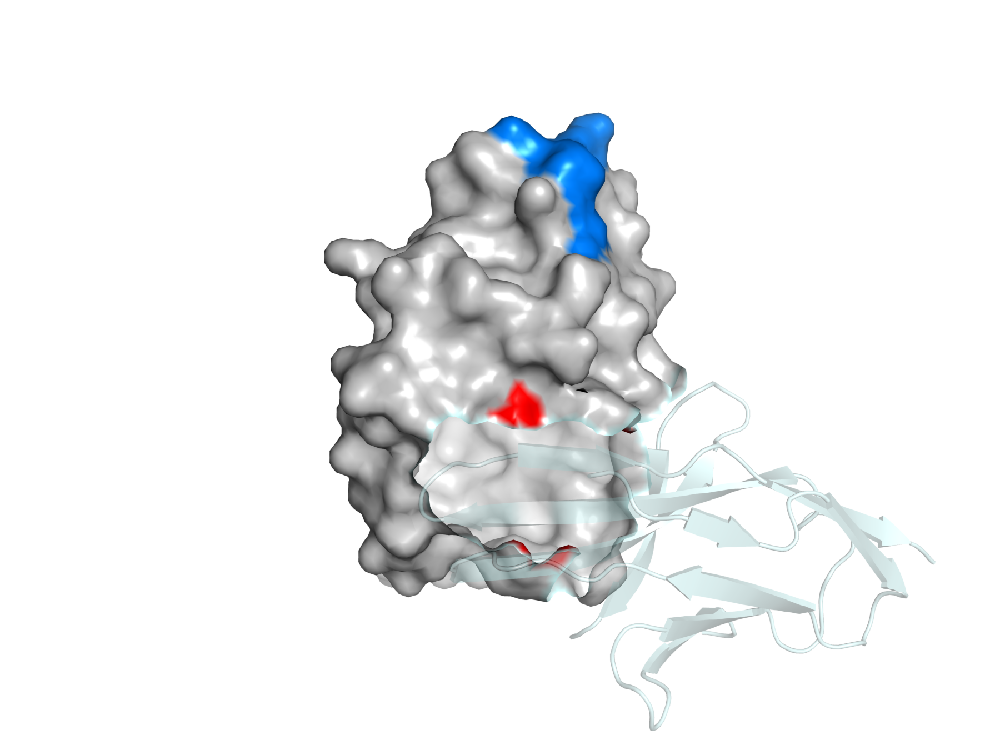

# PD-L1 de novo binder 설계 — 핫스팟 지정이 결과를 바꾸는가

면역항암제의 표적인 PD-L1 단백질에 달라붙도록, 새 단백질을 컴퓨터로
설계했습니다. 묻는 것은 하나입니다. 생성 모델에 **"표면의 이 자리를
겨냥하라"고 지정하면 결과가 달라지는가.**

저는 RFdiffusion으로 PD-L1에 결합하는 binder 백본을 생성한 뒤, 같은
단백질에서 에피토프가 아닌 패치를 향해 생성한 배치와 비교하였습니다.
두 배치는 각각 50건이고, 생성부터 계면 평가와 그림까지 모든 단계를
마쳤습니다.

이 작업의 목표는 쓸 만한 결합제를 찾는 것이 아니었습니다. 핫스팟을
지정했을 때와 지정하지 않았을 때 생성 결과의 분포가 달라지는지를 재는
것이 목적이었고, 그래서 판정 기준과 한계를 실행 전에 미리 적어
두었습니다.

---

## 한눈에 보기

가설 셋과 그 지표는 실행하기 전에
[`preregistration.md`](preregistration.md)에 적어 못 박았습니다.

| 가설 | 묻는 것 | 어느 구조에서 | 재는 방법 | 결과 |
|---|---|---|---|---|
| **가설 H2a** | binder가 지정한 자리에 앉았는가 | RFdiffusion이 내놓은 백본 | CA–CA 8 Å, 핫스팟 4개 중 2개 이상 접촉 | 76% 대 82% = **0.93배**, 불통과 |
| **가설 H2b** | binder가 지정한 자리에 앉았는가 | ProteinMPNN·AF2로 다시 예측한 복합체 | 중원자 4.5 Å, 핫스팟 4개 중 2개 이상 접촉 | 48% 대 4% = **12.0배**, 통과 |
| **가설 H1** | 그 자리에 만들어진 계면이 좋은가 | ProteinMPNN·AF2로 다시 예측한 복합체 | `dG_separated` 중앙값 | −1.77 대 −0.01 REU, 판독 불가 |

H2a와 H2b는 질문이 같고 **재는 구조만 다릅니다.** 앞은 생성기가 내놓은
출력 그대로이고, 뒤는 그 백본에 서열을 설계해 독립 모델로 다시 예측한
복합체입니다. 둘 다 실행 전에 못 박은 기준이며, 중원자 4.5 Å이 원안이었고
사이드체인이 없는 백본에는 쓸 수 없어 CA–CA 8 Å을 함께 두었습니다.

여기서 **중원자**(heavy atom)는 수소를 뺀 원자, 곧 C·N·O·S 를 말합니다.
결정 구조에는 수소가 들어 있지 않은 경우가 많고 예측 구조의 수소 위치도
신뢰도가 낮아, 접촉을 잴 때 관용적으로 제외합니다. 따라서 "중원자 4.5 Å"은
두 잔기의 수소가 아닌 원자 가운데 가장 가까운 쌍이 4.5 Å 이내라는 뜻입니다.
**CA–CA 8 Å**은 잔기당 알파 탄소 하나씩만 보고 그 둘의 거리를 재는 방식으로,
사이드체인이 없을 때 쓰는 더 거친 대용입니다.

#### 왜 이 기준인가

숫자를 임의로 정하지 않았다는 것을 보이기 위해 근거를 적어 둡니다.

| 기준 | 근거 |
|---|---|
| 중원자 4.5 Å | 구조생물학에서 두 잔기가 접촉한다고 볼 때 널리 쓰는 거리입니다. 앞선 작업([vhh-mpnn-selfconsistency](https://github.com/OHfromH2O/vhh-mpnn-selfconsistency))에서 쓴 기준과 같게 맞췄습니다 |
| CA–CA 8.0 Å | 사이드체인이 없는 백본에 쓰는 관용적 대용입니다. 4.5 Å을 백본에 그대로 적용하면 사슬 간 최소 거리 자체가 4.11 Å이라 거의 아무것도 접촉으로 잡히지 않습니다. 8 Å은 설계군에서 계면 잔기 중앙값 11개를 주어 계면 크기로 타당합니다([`notes/h2_cutoff_choice.md`](notes/h2_cutoff_choice.md)) |
| 핫스팟 4개 중 2개 이상 | 하나만 닿아도 겨냥했다고 보기 어렵고, 넷을 모두 요구하면 거의 통과가 없습니다. 절반을 넘기는 최소 조건으로 2개를 잡았습니다 |
| 통과율 2배 이상 | 눈에 띄는 차이의 기준으로 임의로 정한 값입니다. 뒤에서 이 선택 자체가 결함이었음이 드러납니다([결과 1](#1-가설-h2a--지정한-핫스팟을-실제로-접촉하는가)) |
| `pae_interaction` < 10 | dl_binder_design 저자들(Bennett et al. 2023)이 실험 검증된 결합체와 그렇지 않은 설계를 가르는 선으로 보고한 값을 그대로 가져왔습니다 |
| 양성 대조군 `dG_separated` < 0 | 실제로 결합하는 복합체라면 떼어낼 때 에너지가 올라가야 합니다. 음수가 나오지 않으면 지표가 작동하지 않는 것이므로, 설계를 판정하기 전에 걸러냅니다 |

H1의 원래 주 지표는 `pae_interaction`이었습니다. 양성 대조군이 실패해
측정 실패로 보고하고, `dG_separated`를 주 지표로 승격했습니다(사전 등록 §4).
판독 불가는 두 군의 차이 1.76 REU가 측정 정밀도 ±1.7 REU 안에 들어온다는
뜻이며, 분포에서는 차이가 드러납니다([결과 7](#7-가설-h1-판정--분포는-다르고-사전-등록한-통계는-그것을-못-봅니다)).

| 단계 | 도구 | 한 줄 | 상태 |
|---|---|---|---|
| 1 타깃 준비 | RCSB, Biopython | PD-L1 4ZQK 사슬 A(18–132) 추출, PD-1 접촉 잔기 계산 | ✅ |
| 2 핫스팟 선정 | 자체 계산 | 에피토프 4개 + **비-에피토프 대조 4개**(소수성 4/4 일치) | ✅ |
| 2′ 선정 검증 | PyRosetta Ala 스캔 | 고른 3개가 접촉 잔기 17개 중 **1·2·3위**, 세 프로토콜에서 재현 | ✅ |
| 3 사전 등록 | — | 판정 기준·한계를 실행 **전에** 고정 (선후는 커밋으로 증명 불가 — 사전 등록 §0) | ✅ |
| 4 백본 생성 | RFdiffusion (Colab T4) | 설계 **50** + 대조 **50**, T=50, binder 70–100 aa | ✅ 100/100 |
| 5 H2a 계면 위치 | 자체 스크립트 | CA–CA 8 Å 접촉, 지정 핫스팟 2개 이상 접촉 비율 | ✅ |
| 5′ H2b 계면 위치 | 자체 스크립트 | **중원자 4.5 Å**(사전 등록 원안) — AF2 복합체에서 측정 | ✅ **통과 12.0배** |
| 6 H1 계면 품질 | ProteinMPNN · AF2 · PyRosetta | `pAE_interaction`, `dG_separated` | ✅ 100/100 |
| 7 그림 | PyMOL (헤드리스) | 패치 위치, 대표 복합체 2종 — `.pml`을 데이터에서 생성해 커밋 | ✅ |

세 줄 요약

1. **핫스팟 지정은 작동합니다. 다만 백본을 만든 생성 모델의 출력만
   보아서는 그 사실을 확인할 수 없습니다.**

   백본을 만드는 생성 모델은 RFdiffusion입니다. 여기에 "PD-L1 표면의 이
   네 잔기를 겨냥하라"고 지정하면 binder는 실제로 그 자리에 앉습니다.
   그런데 PD-1이 진짜로 붙는 자리(에피토프)를 지정했을 때와, 일부러 고른
   다른 자리를 지정했을 때가 **76% 대 82%**로 거의 같습니다. 에피토프라는
   사실 자체는 겨냥 성공률을 올리지 않습니다(가설 H2a, 불통과).

   같은 백본에 ProteinMPNN으로 아미노산 서열을 설계하고 AF2로 복합체를
   다시 예측한 다음, 똑같은 질문을 그 구조에 던지면 **48% 대 4%, 곧
   12.0배**로 갈립니다(가설 H2b, 통과). 생성 모델의 출력은 두 자리를
   구별하지 못하고, 독립된 모델이 다시 예측했을 때에야 차이가 드러납니다.

2. **계면의 질도 같은 방향을 가리킵니다.**

   계면의 질은 PyRosetta로 잰 `dG_separated`로 봅니다. 두 군의 중앙값은
   −1.77과 −0.01 REU로, 차이가 측정 정밀도 ±1.7 REU 안에 들어와 읽을 수
   없습니다(가설 H1). 사전 등록에서 중앙값 비교를 약속했으므로 그대로
   보고합니다.

   그런데 분포를 보면 갈립니다. 잴 만한 계면을 실제로 만든 설계가
   **24/50 대 1/50**입니다. 나머지 설계는 AF2 재예측에서 binder가 타깃에서
   떨어져 나가 계면 자체가 없습니다
   ([결과 7](#7-가설-h1-판정--분포는-다르고-사전-등록한-통계는-그것을-못-봅니다)).

3. **위치·크기·에너지 세 축이 같은 설계 집합을 가리킵니다.**

   에너지 상위 8건이 **전부 설계군**이고, 그 8건이 모두 지정한 핫스팟
   네 개에 닿았으며 가설 H2b도 통과합니다. 대조군에서 유일하게 에너지가
   좋았던 `ctrl_12`는 지정 핫스팟을 **하나도** 접촉하지 않았습니다. 괜찮은
   계면을 만들기는 했지만 겨냥한 자리가 아닙니다
   ([결과 9](#9-세-축의-교차--같은-설계-집합을-가리킵니다)).

   다만 세 축은 모두 같은 AF2 구조에서 계산되므로 서로를 독립적으로
   확증하지는 못합니다([한계 19](#limit-19)).

<details open>
<summary><b>목차</b></summary>

- [한눈에 보기](#한눈에-보기)
- [용어](#용어)
  - [도구가 내는 지표와 읽는 법](#도구가-내는-지표와-읽는-법)
- [이 문서를 읽는 법](#이-문서를-읽는-법)
- [설계](#설계)
- [결과](#결과)
  - [(1) 가설 H2a — 지정한 핫스팟을 실제로 접촉하는가](#1-가설-h2a--지정한-핫스팟을-실제로-접촉하는가)
  - [(1-b) 배치 간 재현성](#1-b-배치-간-재현성)
  - [(2) 핫스팟별 접촉률 — 네 잔기가 고르게 쓰이지 않습니다](#2-핫스팟별-접촉률--네-잔기가-고르게-쓰이지-않습니다)
  - [(3) 계면 크기 — 사후 관찰](#3-계면-크기--사후-관찰)
  - [(4) 백본 품질](#4-백본-품질)
  - [(5) 핫스팟 선정의 사후 검증 — 세 프로토콜이 같은 답을 냅니다](#5-핫스팟-선정의-사후-검증--세-프로토콜이-같은-답을-냅니다)
  - [(6) 가설 H1 1·2단계 — 양성 대조군 둘이 서로 다른 답을 냈습니다](#6-가설-h1-12단계--양성-대조군-둘이-서로-다른-답을-냈습니다)
  - [(7) 가설 H1 판정 — 분포는 다르고, 사전 등록한 통계는 그것을 못 봅니다](#7-가설-h1-판정--분포는-다르고-사전-등록한-통계는-그것을-못-봅니다)
  - [(8) 가설 H2b — 중원자 4.5 Å으로 재면 통과합니다](#8-가설-h2b--중원자-45-å으로-재면-통과합니다)
  - [(9) 세 축의 교차 — 같은 설계 집합을 가리킵니다](#9-세-축의-교차--같은-설계-집합을-가리킵니다)
  - [(10) 그림 — 세 숫자가 한 장에 보입니다](#10-그림--세-숫자가-한-장에-보입니다)
- [한계](#한계)
- [다음 단계](#다음-단계)
- [실행 환경](#실행-환경)
- [산출물](#산출물)
- [재현](#재현)
- [라이선스 고지](#라이선스-고지)

</details>

---

## 용어

| 말 | 뜻 |
|---|---|
| **타깃**(target) | 달라붙을 대상 단백질. 여기서는 PD-L1 |
| **binder** | 타깃에 달라붙도록 새로 만든 단백질 |
| **패치**(patch) | 타깃 표면의 한 구역. 여기서는 핫스팟 네 개가 모여 있는 자리를 말합니다 |
| **배치**(batch) | 한 번에 돌린 생성 묶음. 군마다 25건짜리 배치를 두 번 돌려 50건을 모았습니다. 패치는 단백질 위의 자리, 배치는 실행 단위입니다 |
| **에피토프**(epitope) | 타깃 표면에서 상대가 실제로 달라붙는 자리 |
| **핫스팟**(hotspot) | 그 자리 가운데 결합에 특히 크게 기여하는 잔기 몇 개. 생성 모델에 "여기를 겨냥하라"고 넣는 입력 |
| **백본**(backbone) | 단백질 사슬의 뼈대. 곁가지를 뺀 N·CA·C·O 원자만 |
| **잔기**(residue) | 단백질을 이루는 아미노산 하나. `A56`은 사슬 A의 56번 잔기 |
| **RFdiffusion** | 백본을 새로 만들어 내는 생성 모델 |
| **ProteinMPNN** | 주어진 백본에 어울리는 아미노산 서열을 고르는 모델 |
| **AlphaFold2**(AF2) | 서열에서 구조를 예측하는 모델. 여기서는 설계가 정말 그 모양으로 접히는지 다시 확인하는 심판 역할 |
| **PyRosetta** | 물리 기반으로 에너지를 계산하는 도구 |
| **`dG_separated`** | 붙어 있는 복합체를 둘로 떼어낼 때의 에너지 차이. 음수일수록 붙어 있는 쪽이 유리. 단위는 REU이며 kcal/mol이 아님 |
| **`pae_interaction`** | 두 사슬의 상대 위치를 AF2가 얼마나 확신하는지. 낮을수록 확신 |
| **`dSASA_int`** | 결합으로 가려지는 표면적. 계면의 크기 |
| **Ala 스캔** | 잔기를 하나씩 알라닌으로 바꿔 결합이 얼마나 나빠지는지 재는 방법. 핫스팟을 규정하는 표준 수단이며, 이 작업에서는 순서를 뒤집어 구조적 직관으로 고른 핫스팟이 타당했는지 사후에 검증하는 데 썼습니다 ([결과 5](#5-핫스팟-선정의-사후-검증--세-프로토콜이-같은-답을-냅니다)) |
| **사전 등록**(pre-registration) | 실행하기 전에 판정 기준과 한계를 문서로 고정하는 것 |

### 도구가 내는 지표와 읽는 법

| 도구 | 내는 지표 | 어떻게 읽는가 |
|---|---|---|
| RFdiffusion | 좌표만 (지표 없음) | 자체 신뢰도 점수를 내지 않습니다. 좋은 백본인지는 뒤 단계가 판정합니다 |
| ProteinMPNN | 아미노산 서열 | 백본에 어울리는 서열을 고릅니다. 이 단계도 결합을 보장하지 않습니다 |
| AF2 initial guess | `pae_interaction` | 두 사슬의 상대 위치를 얼마나 확신하는지. 낮을수록 확신. 보고된 기준은 10 미만이지만, 이 작업에서는 영점이 확인되지 않아 판정에 쓰지 않았습니다([결과 6](#6-가설-h1-12단계--양성-대조군-둘이-서로-다른-답을-냈습니다)) |
| AF2 initial guess | `plddt_binder` | binder 부분이 얼마나 확실하게 접혔는지, 0–100. 높다고 정확한 것은 아닙니다 |
| AF2 initial guess | `binder_aligned_rmsd` | 예측된 구조가 설계한 백본과 얼마나 겹치는지(Å). 작을수록 설계대로 접힌 것 |
| PyRosetta | `dG_separated` | 붙어 있는 복합체를 둘로 떼어낼 때의 에너지 차이. 음수일수록 붙어 있는 쪽이 유리. 단위는 REU이며 kcal/mol이 아니라 절대값을 친화도로 읽을 수 없습니다 |
| PyRosetta | `dSASA_int` | 결합으로 가려지는 표면적(Ų). 계면의 크기이고, 0에 가까우면 계면이 없다는 뜻입니다 |
| PyRosetta | `hbonds_int` | 계면을 가로지르는 수소결합 개수 |
| 자체 스크립트 | 핫스팟 접촉 수 | 지정한 네 잔기 가운데 몇 개에 닿았는지. 2개 이상이면 성공으로 셉니다 |


---

## 이 문서를 읽는 법

먼저 이 작업이 무엇을 주장하지 않는지부터 적겠습니다. RFdiffusion 논문의
binder 설계는 수천에서 수만 개의 backbone을 생성한 뒤 그 가운데 극소수를
실험으로 검증합니다. 이 작업은 그룹당 50건이고 실험 검증이 없으므로,
좋은 결합제를 찾았다고 말할 수는 없습니다. 말할 수 있는 것은 두 배치의
분포가 서로 다른가 하나뿐입니다.

판정 기준은 전부 [`preregistration.md`](preregistration.md)에 실행 전에
적어 두었습니다. 결과를 본 뒤에 기준을 고치지는 않았고, 고친 곳은 날짜와
경위를 함께 남겼습니다([§5 수정](preregistration.md),
[`notes/h2_cutoff_choice.md`](notes/h2_cutoff_choice.md)).

---

## 설계

| | 설계군 | 대조군 |
|---|---|---|
| 핫스팟 | A56 Tyr, A115 Met, A121 Ala, A123 Tyr | A32 Tyr, A106 Leu, A109 Ala, A132 Ala |
| 정체 | PD-1 결합 부위(에피토프) | 비-에피토프 표면 |
| 소수성 | 4/4 | 4/4 |
| 방향족 | 2 | 1 |

대조군이 이 작업의 핵심입니다. 핫스팟 없이도 binder가 우연히 그 자리에
앉을 수 있고, 그 가능성을 배제하지 않으면 "지정했더니 거기 붙었다"는
아무 의미가 없습니다. 소수성을 4/4로 맞춘 데에는 이유가 있습니다. 단백질끼리 달라붙는 자리는
대개 물을 밀어내는 소수성 면입니다. 물과 잘 어울리는 극성 면에는 binder가
잘 붙지 않는데, 결합하려면 이미 자리를 차지한 물 분자를 떼어내야 하고
극성 면은 물을 단단히 붙들고 있기 때문입니다. 대조 패치를 극성으로
골랐다면 대조군이 실패해도 "에피토프가 아니라서"인지 "극성이라 원래
어려운 자리라서"인지 가릴 수 없습니다. 네 잔기를 모두 소수성으로 맞춰
그 설명을 미리 지웠습니다. 방향족 수는 맞추지 못했습니다([한계 4](#limit-4)).

---

## 결과

### (1) 가설 H2a — 지정한 핫스팟을 실제로 접촉하는가

> RFdiffusion이 내놓은 백본에서는 두 패치가 거의 같은 비율로 겨냥됩니다.
> 76% 대 82%로, 미리 정해 둔 2배 기준에 미치지 못합니다. 같은 가설을 AF2
> 복합체에서 원안 기준으로 재면 12.0배로 통과하므로
> ([결과 8](#8-가설-h2b--중원자-45-å으로-재면-통과합니다)), 두 절을 함께 보셔야 합니다.

CA–CA 8.0 Å 이내 접촉, 지정 핫스팟 4개 중 2개 이상이면 성공
(기준의 유래는 [`notes/h2_cutoff_choice.md`](notes/h2_cutoff_choice.md)).

| | 설계 | 대조 |
|---|---|---|
| n | 50 | 50 |
| **핫스팟 2개 이상** | **38/50 = 76%** | **41/50 = 82%** |
| 95% CI (Wilson) | 63–86% | 69–90% |
| 3개 이상 | **19/50** | 12/50 |
| 접촉 수 중앙값 | 2 / 4 | 2 / 4 |

접촉 수 분포 (0 / 1 / 2 / 3 / 4):

| 설계 | 4 / 8 / 19 / 17 / 2 |
|---|---|
| 대조 | 1 / 8 / 29 / 12 / 0 |

사전 등록 §5 H2: 0.93배. 기준 2.0배 이상 — 불통과.
대조군 쪽이 6포인트 높지만 "대조군이 더 잘 겨냥됐다"고 말할 수도
없습니다. 95% 신뢰구간이 63–86%와 69–90%로 크게 겹치기 때문입니다.
신뢰구간은 같은 실험을 반복했을 때 참값이 들어 있을 범위이고, 두 범위가
이만큼 겹친다는 것은 참값이 서로 같아도 이 정도 차이는 우연히 나올 수
있다는 뜻입니다. n=50에서는 한두 건만 뒤집혀도 순서가 바뀝니다.

### (1-b) 배치 간 재현성

> 네 배치로 나눠 봐도 결론이 같습니다. 대조군 한 배치만 높았고 나머지 셋은 19/25로 같았습니다.

양 군 모두 25건씩 두 배치로 나뉘어 돌았습니다. 각 군 안에서 핫스팟·contig·
`diffuser.T`·설계 수가 전부 동일하고 난수 시드만 다릅니다.

| 배치 | 통과 | 95% CI | 계면 중앙값 |
|---|---|---|---|
| `pdl1_epi` | 19/25 = 76% | 57–89% | 11 |
| `pdl1_epi2` | 19/25 = 76% | 57–89% | 12 |
| `pdl1_ctrl` | 19/25 = 76% | 57–89% | 6 |
| `pdl1_ctrl2` | **22/25 = 88%** | 70–96% | 5 |

네 배치 중 셋이 정확히 19/25입니다. 변동은 `ctrl2` 한 배치에만
나타났고 다른 세 배치에서 재현되지 않았습니다. 따라서 대조군 82%는
76%쪽으로 읽는 것이 보수적이고, 두 군의 신뢰구간은 크게 겹칩니다.
H2a로는 두 군이 구별되지 않습니다.

군마다 배치가 둘뿐이므로 "설계군이 더 재현성 있다"와 "`ctrl2`가 운이
좋았다"를 구별할 수는 없습니다. 분산을 추정하기에 n=2는 부족합니다.

계면 중앙값은 네 배치에서 11 / 12 / 6 / 5로 군을 따라 갈립니다.
통과율과 달리 배치가 아니라 패치가 결정합니다.

이상치 1건. `pdl1_ctrl2_6`은 계면 잔기가 0개입니다. 8 Å 안에 아무것도
없습니다. binder가 타깃에서 떨어져 나온 것으로 보입니다. 설계군의 최솟값은
1이고, 0은 대조군에만 나타났습니다.


이 결과는 두 가지를 동시에 말합니다.

하나는 도구가 작동한다는 것입니다. RFdiffusion의 핫스팟 지정 설정
(`ppi.hotspot_res`)은 지정한 자리가 에피토프든 아니든 똑같이 binder를
그 자리로 보냈습니다. 76%와 82%는 둘 다 높은 값입니다.

다른 하나는 에피토프라는 사실 자체가 겨냥 성공률을 올리지는 않는다는
것입니다. 이쪽이 가설 H2a에 대한 답이고, 답은 "차이 없음"입니다. 가설이
지지되지 않은 것도 결과이므로 그대로 보고합니다.

> 돌아보면 기준 자체가 잘못 설계되었습니다. 사전 등록에서 저는 "설계군의
> 통과율이 대조군의 2배 이상이면 H2 통과"로 정해 두었습니다. 그런데 H2가
> 재는 것은 binder가 어디에 앉았는가라는 위치뿐입니다. 핫스팟 지정이
> 제대로 작동하면 에피토프든 아니든 양쪽 모두 높게 나오는 것이 정상이므로,
> 2배라는 간격이 나올 자리가 애초에 아니었습니다. 에피토프의 특별함은
> 위치가 아니라 그 자리에 만들어진 계면의 질에서 나타나야 하고, 그것을
> 재는 것이 H1입니다. 이 결함은 결과를 본 뒤에 알게 되었으므로 그대로
> 기록하며, 기준을 사후에 고치지 않았습니다.

### (2) 핫스팟별 접촉률 — 네 잔기가 고르게 쓰이지 않습니다

> 같은 패치 안에서도 잔기마다 접촉률이 3.5배까지 벌어집니다. 핫스팟 네 개를 한 덩어리로 볼 수 없습니다.

| 설계군 (n=50) | 대조군 (n=50) |
|---|---|
| A121 **40/50** (80%) | A132 **38/50** (76%) |
| A115 27/50 (54%) | A106 36/50 (72%) |
| A123 26/50 (52%) | A109 16/50 (32%) |
| A56 **12/50** (24%) | A32 **12/50** (24%) |

같은 패치의 네 잔기인데 접촉률이 3.5배까지 벌어집니다. 양쪽 모두 한 잔기가
뚜렷하게 낮습니다(A56, A32). 네 잔기를 똑같은 무게로 지정했지만 binder는 넷을 고르게
덮지 않았습니다. 패치 안에서 한쪽으로 치우쳐 앉습니다.

이것은 미리 정해 두지 않은 관찰입니다. 원인(패치 내 좌표 거리, 표면
노출도)은 측정하지 않았습니다.

### (3) 계면 크기 — 사후 관찰

> 통과율은 같은데 계면 잔기 수는 설계군이 2.4배 많습니다. 미리 정해 두지 않은 사후 관찰입니다.

| | 중앙값 | 범위 | binder 길이 중앙값 |
|---|---|---|---|
| 설계 (n=50) | **12** | 1–17 | 86 |
| 대조 (n=50) | **5** | 0–17 | 83 |

비슷한 길이의 binder가 에피토프 패치에서 2.4배 넓은 계면을 만듭니다.
양 군을 50건으로 늘렸을 때 격차는 좁아지지 않고 더 벌어졌습니다.
H2a 통과율과 달리 이쪽은 방향이 뒤집히지 않고 네 배치 모두에서 군을 따라
갈립니다(11 / 12 / 6 / 5). 접촉 수 분포의 모양도 다릅니다. 대조군은
29/50이 정확히 2개에 몰려 "겨우 통과"하는 반면, 설계군은 19/50이 3개
이상입니다.

통과율은 같은데 닿는 면적이 다릅니다. H2a는 "핫스팟 2개 이상에
닿았는가"만 묻기 때문에, 겨우 닿은 설계와 넓게 덮은 설계를 구별하지
못합니다. 계면 잔기 수는 그 구별을 담고 있고, 여기서 두 군이 갈립니다.

이것이 사실이라면 계면의 질을 재는 H1에서도 설계군이 나아야 합니다.
닿는 면이 넓을수록 결합 에너지가 좋아질 여지가 크기 때문입니다. 실제로
뒤에서 그렇게 됩니다(결과 7, 결과 9).

방향도 구조와 맞습니다. PD-1이 붙는 자리는 넓고 움푹한 소수성 홈(cleft)
이므로, 그 자리를 겨냥한 binder가 더 넓게 닿는 것은 자연스럽습니다.

미리 정해 둔 기준이 아닙니다. 결과를 본 뒤 눈에 들어온 양이고, 통계
검정을 하지 않았으며, [한계 4](#limit-4)(방향족 2 vs 1)가 그대로 걸립니다. 넓은 계면이
에피토프이기 때문인지 방향족이 하나 더 많아서인지 이 설계로는 분리되지
않습니다. 보조 관찰에 해당합니다.

### (4) 백본 품질

> 생성 자체는 정상이었습니다. 타깃 백본이 100건 전 구간에서 0.12–0.15 Å 안에 머물렀습니다.

motif RMSD가 100건 전 구간에서 0.12–0.15 Å입니다. 타깃 백본이 확산 과정에서
흔들리지 않았다는 뜻이고, 생성 자체는 정상적으로 수행되었습니다.

### (5) 핫스팟 선정의 사후 검증 — 세 프로토콜이 같은 답을 냅니다

> 직관으로 고른 핫스팟 세 개가 Ala 스캔에서 접촉 잔기 17개 중 1·2·3위였습니다. 계산 방식 셋 모두 같은 순위를 냅니다.

에피토프 핫스팟 4개는 "PD-1과 4.5 Å 이내 접촉 + 소수성 + cleft 중심"이라는
구조적 직관으로 골랐습니다. 에너지 기준이 아니었습니다.

- 한 것 — 그 선정이 타당했는지를 [`scripts/ala_scan.py`](scripts/ala_scan.py)로
  사후에 검증했습니다. 접촉 잔기를 하나씩 Ala로 치환한 뒤 계면 에너지의
  변화량(ddG)으로 순위를 매기는 방식입니다.
- 하지 않은 것 — 그 결과로 핫스팟을 바꾸지 않았습니다. 이미 생성된 배치의
  입력을 사후에 고치면 사전 등록이 무의미해집니다.

같은 계산을 세 가지 방식으로 돌렸습니다. 셋은 구조를 이완(relax)시키는지,
그리고 반복 측정에서 어느 값을 대표로 삼는지가 다릅니다. 이완은 치환
직후의 어색한 원자 배치를 에너지가 낮은 쪽으로 풀어 주는 과정입니다.

| 프로토콜 | 이완 | 대표값 |
|---|---|---|
| 이완 없음 | 안 함 | 1회 측정 |
| 이완 + 중앙값 | 사이드체인만 | 반복 3회의 중앙값 |
| 이완 + best-of-N | 사이드체인만 | 반복 3회 중 결합 상태 에너지가 가장 낮은 것 |

세 방식이 같은 순위를 낸다면, 그 순위는 계산 설정에 기대어 나온 것이
아닙니다.

| 잔기 | 이완 없음 | 이완 + 중앙값 | 이완 + best-of-N | |
|---|---|---|---|---|
| A123 TYR | **+5.35** (1위) | **+6.56** (1위) | **+6.93** (1위) | ★ 고른 것 |
| A115 MET | **+3.79** (2위) | **+4.25** (2위) | **+6.23** (2위) | ★ 고른 것 |
| A56 TYR | **+3.41** (3위) | **+2.97** (3위) | **+3.44** (3위) | ★ 고른 것 |
| 4위 | A54 ILE +1.97 | A122 ASP +2.66 | A122 ASP +1.98 | |
| 자기검정 (잡음 바닥) | 정확히 0.00 | 0.40 → 신호 7.4배 | 0.90 → **신호 3.8배** | |
| WT `dG_separated` | +94.05 (지표 실패) | −32.69 (성립) | **−32.69** (성립) | |
| 순위가 흔들린 행 | 0/17 | **9/17** | **0/17** | |

고른 4개 중 측정 가능한 3개가 접촉 잔기 17개에서 1·2·3위입니다.
세 프로토콜이 순위뿐 아니라 ddG 값까지 ±2 REU 안에서 일치합니다. 4위와의
간격도 뚜렷합니다. 잡음 바닥이 0.40 → 0.90으로 올라가 신호비는 7.4배에서
3.8배로 내려갔습니다. best-of-N 이 추정을 바꾸면서 음성 대조의 값도
함께 바뀌었기 때문이고, 더 보수적인 숫자입니다. 직관으로 고른 선정이 에너지 기준으로도 상위였습니다.
"핫스팟을 잠정적으로 골랐다"는 유보는 해소되었습니다.

#### best-of-N 으로 양봉이 정리되었습니다 (2026-11-04)

양봉(bimodal)은 같은 조건으로 반복 측정했을 때 값이 두 덩어리로 갈리는
것을 말합니다. 평균 주위에 고르게 흩어지는 것이 아니라, 예컨대 −32 근처와
−70 근처처럼 멀리 떨어진 두 자리에 모입니다. 그러면 중앙값은 어느 덩어리에
표가 더 몰렸는지에 따라 뒤집히므로 순위를 믿을 수 없게 됩니다.

중앙값 프로토콜에서 17개 행 중 9개가 반복 산포 ~37 REU의 양봉을
보였습니다(옛 [한계 11](#limit-11)). 원인을 나쁜 이완으로 특정했고, 올바른 추정량은
중앙값이 아니라 이완 N회 중 `bound`(결합 상태 총 에너지)가 가장 낮은 것을
고르는 best-of-N 이라고 판단했습니다. 그대로 구현해 다시 돌린 결과입니다.

| | 중앙값 | best-of-N |
|---|---|---|
| 순위가 흔들린 행 | 9/17 | **0/17** |
| 선택된 `dG_separated` | −70 ~ −32 (양봉) | **−33.9 ~ −25.8** (단조) |
| 고른 3개의 순위 | 1·2·3 | 1·2·3 |

선택된 `dG`가 −33.87에서 −25.76까지 매끄러운 사다리를 이룹니다. 순위가
뒤섞인 행이 없습니다. 양봉은 추정량을 고르는 방식의 문제였고, 해소되었습니다.

`choice_gap` 열은 해석에 주의가 필요합니다. 이 열은 최저 `bound` 구조와
최고 `bound` 구조의 `dG` 차이인데, 이것을 "추정의 불확실성"으로 읽으면
`choice_gap > |ddG|`인 행에 경고를 달게 됩니다. 그러면 17행 중 10행이
걸리지만, 그 판정은 데이터와 맞지 않습니다.

`choice_gap`은 `ala_scan_bestofn.csv`의 한 열이고, 값은 이렇게 갈립니다.

| 잔기 | ddG | 선택된 `dG` | `choice_gap` |
|---|---|---|---|
| A123 | +6.93 | −25.76 | 0.85 |
| A115 | +6.23 | −26.46 | 1.94 |
| A122 | +1.98 | −30.71 | 37.74 |
| A19 | +0.38 | −32.31 | 37.75 |

- `choice_gap` 자체가 이중 분포입니다: 0~2(7행) 또는 34~40(10행), 중간이
  없습니다.
- 그런데 선택된 `dG`는 매끄러운 사다리입니다. `A19`는 `choice_gap` 37.75인데
  `dG` −32.31로 `A23`(−32.27)과 `A125`(−32.49) 사이에 정확히 들어갑니다.

즉 `choice_gap`은 버려진 나쁜 분지까지의 거리이고, 값이 크다는 것은
best-of-N 이 제대로 걸러냈다는 신호입니다. 경고해야 할 경우는 오히려 반대인데, 두
분지가 깨끗하게 갈리지 않는 중간값(5~20 REU)일 때 어느 쪽을 버려야
하는지가 모호해집니다. 규칙을 그렇게 고쳤고, 현재 데이터에서는 0행이
걸립니다(실제 분포가 이중이므로 맞는 동작입니다).

A121은 측정 불가입니다. 원래 Ala이므로 Ala로 바꿔도 잃을 사이드체인이
없습니다. ddG가 0에 가깝게 나오지만, 이것은 기여가 없다는 뜻이 아니라
이 방법으로 측정할 수 없다는 의미입니다. 접촉률이 가장 높았던(40/50) 잔기가 하필
측정 불가입니다.

자기검정. 계면에 없는 비-에피토프 핫스팟 4개를 함께 스캔했습니다.
이완이 없으면 `|ddG|`가 정확히 0.00입니다. 버그가 아니라 가장 강한
통과 형태입니다. `dG_separated`는 (결합) − (분리 후 재배치)이고
`pack_separated`의 재배치는 계면 잔기로 제한되므로 계면 밖 잔기의 내부
에너지는 두 항에서 정확히 상쇄됩니다. 이완을 켜면 전체 사이드체인이
움직여 상쇄가 깨지므로 고정 임계 판정을 하지 않고, 음성 대조의 산포
(0.40 REU)를 잡음 바닥으로 삼아 신호 배수를 봅니다.

#### 지표의 실패와 수정 — 이완이 부호를 뒤집습니다

```
이완 없음   dG_separated   +94.05 REU   hbonds_int 5   dSASA_int 1671 A^2
이완 (sc)   dG_separated   -32.69 REU   hbonds_int 8   dSASA_int 1600 A^2
```

실제로 결합하는 공결정인데, 이완 없이 재면 "결합 상태가 분리 상태보다
94 REU 나쁘다"고 나옵니다. 부호가 거꾸로입니다.

진단은 이렇습니다.

- 계면 자체는 올바르게 잡혔습니다. `dSASA_int`가 1671 Ų로 PD-1/PD-L1
  계면에 타당한 크기입니다.
- 문제는 에너지 쪽이고, 원인은 결합 상태를 이완시키지 않은 것입니다.
- 분리 상태는 떼어낸 뒤 사이드체인을 재배치해 결정 구조의 작은 충돌을
  풀 수 있지만, 결합 상태는 상대 사슬에 막혀 그러지 못합니다. 한쪽만
  유리해지므로 차이가 거꾸로 나옵니다.

사이드체인만 이완하면 127 REU가 움직여 부호가 뒤집히고, 수소결합이
5개에서 8개로 늘어납니다.

따라서 이완 없는 `dG_separated`의 절댓값 기준은 쓸 수 없습니다. native
복합체조차 통과하지 못합니다. 이전 작업에서 AF2의 ipTM이 native에서 0.12가
나와 계면에 대해 아무 말도 할 수 없게 된 것과 같은 종류의 실패이며,
같은 방식으로(양성 대조군을 먼저 돌려서) 미리 잡혔습니다. H1에서는
FastRelax가 선행해야 합니다.
[`notes/rosetta_port_plan.md`](notes/rosetta_port_plan.md)에 기록했습니다.

#### 남은 결함 — 양봉, 그리고 그 원인

이완을 켠 실행에서 17개 행 중 9개가 반복 산포 ~37–40 REU를 보입니다.
3회 반복 중 일부가 약 37 REU 낮은 상태로 떨어지고, 중앙값이 어느 봉우리에
표가 몰리는지로 뒤집힙니다.

원인은 H1 게이트를 준비하며 특정되었습니다. 4ZQK 복합체를 10회
반복해 `dG_separated`와 결합 상태 총 에너지(`bound`)를 함께 기록했습니다.

| `bound` 순위 | 1 | 2 | … | 8 | **9** | **10** |
|---|---|---|---|---|---|---|
| `bound` (REU) | −351 | −348 | … | −332 | **−330** | **−318** |
| `dG_sep` (REU) | −32.9 | −32.7 | … | −33.1 | **−70.3** | **−69.4** |

−70은 이완이 가장 나빴던 두 실행에서만 나왔습니다. 선형 상관이 아니라
문턱이고, 이완이 충분히 안 되면 해소되지 않은 것이 남아 dG가 터집니다.
그리고 같은 pose에 `InterfaceAnalyzerMover`를 반복하면 완전히 동일한
값이 나옵니다(−32.74 × 5) — 점수화 자체는 결정론적입니다.

따라서 변동의 원천은 이완 하나이고, 올바른 추정량은 중앙값이 아니라
`bound`가 가장 낮은 이완을 고르는 best-of-N입니다. 중앙값은 좋은 이완과
나쁜 이완을 섞습니다. [`scripts/h1_rosetta.py`](scripts/h1_rosetta.py)가
이 프로토콜을 씁니다.

측정 정밀도는 약 ±1.7 REU입니다. 진단 10회 중 정상이던 8회의 dG
범위입니다. 군 간 차이를 이보다 세밀하게 읽을 수 없습니다.

> 이 진단은 한 번 다른 결론을 거쳤습니다. `bound` 두 값이 1.6 REU
> 차이인데 dG가 37 REU 달랐으므로, 처음에는 분리 상태 재배치가 간헐적으로
> 실패하는 것으로 읽혔습니다. 그러나 그 두 값은 `bound` 순위 맨 아래에
> 인접한 둘이었고, 점수화 반복이 모두 같은 값을 내면서 원인이 이완 쪽임이
> 드러났습니다. 프로토콜은 그대로 두어도 되었지만 이유가 바뀐 것입니다.
> 판정 규칙도 "두 산포가 모두 크면 이완 문제"로는 연속 변동과 이산 점프를
> 구별하지 못해, 정렬 후 최대 인접 간격을 범위로 나누는 방식으로 고쳤습니다.

`ala_scan.py`는 아직 중앙값을 씁니다. 양봉 9개 행은 같은 원인일
가능성이 높고 best-of-N으로 정리될 것입니다. 다만 고른 3개의 결론은 두
프로토콜에서 재현되었으므로 재실행을 H1 뒤로 미룹니다(다음 단계 E).

고른 3개의 판정은 영향받지 않습니다. A56은 산포 1.55로 정상이고,
A115·A123은 산포가 크지만 중앙값이 이완 없는 실행과 ±1 REU로 일치합니다.
두 독립 프로토콜이 같은 답을 주므로 1·2·3위는 읽을 수 있습니다. 하위
순위, 특히 A76의 −38.95는 인공물이므로 읽을 수 없습니다.

이 결함은 반복을 3회로 했기 때문에 걸렸습니다. 1회였다면 단일 값을
그대로 믿었을 것입니다.

> 앞선 실행에서 더 큰 결함을 하나 잡아 고쳤습니다. 처음 이완을 넣었을
> 때 돌연변이체만 이완을 두 번 받는 비대칭이 있었습니다(이미 이완된 WT를
> 복제해 치환한 뒤 또 이완). FastRelax가 1회로 수렴하지 않으므로 모든 ddG가
> 음수로 끌려가 A56이 +3.41 → −35.86으로 뒤집혔습니다. WT와 돌연변이체가
> 똑같이 "이완하지 않은 parent 복제 → (치환) → 이완 1회"를 거치도록 공통
> 경로로 묶어 고쳤고, 그 뒤 순위가 복원되었습니다. 복제된 pose가 부모의
> extra score를 물려받아 ddG가 정확히 0으로 나오는 경로도 함께 막았습니다
> (`clearPoseExtraScores`).

---

### (6) 가설 H1 1·2단계 — 양성 대조군 둘이 서로 다른 답을 냈습니다

> 지표가 쓸 만한지부터 쟀습니다. 둘 중 하나는 통과하고 하나는 실패해, 실패한 쪽은 판정에 쓰지 않습니다.

백본 100건 → ProteinMPNN(서열 1개/백본) → AF2 initial guess 재예측. 전부
100/100 완료했습니다(Colab L4, MPNN 병렬 25.7분, AF2 군별 59분).

설계를 판정하기 전에 지표가 쓸 만한지부터 쟀습니다. 결합하는 것이 이미
알려진 구조를 넣어 보고, 지표가 그것을 결합으로 알아보지 못하면 그 지표로는
설계를 판정할 수 없습니다. 지표가 둘이므로 게이트도 둘입니다.

| | 무엇을 검정하는가 | 무엇을 넣는가 |
|---|---|---|
| 게이트 A | PyRosetta의 `dG_separated` | PD-L1과 PD-1이 붙어 있는 4ZQK 복합체 그대로 |
| 게이트 B | AF2의 `pae_interaction` | 같은 복합체에서 PD-1을 binder 자리에 놓고 다시 예측 |

A는 이미 있는 구조의 에너지를 재기만 하면 되고, B는 구조를 처음부터 다시
예측해야 합니다. 그래서 B가 더 어려운 시험이고, 실제로 B만 실패했습니다.

| 게이트 | 지표 | 입력 | 결과 | 판정 |
|---|---|---|---|---|
| A | `dG_separated` | 4ZQK 전체 복합체 | **−32.74 REU** | ✅ 통과 |
| B | `pae_interaction` | native PD-1 (4ZQK 사슬 B) | **26.06** | ❌ 실패 |

게이트 B의 실패 원인은 특정되었습니다.

- AF2 initial guess는 MSA(유사 서열 정렬)를 쓰지 않습니다
  (`max_msa_clusters = 5`, 입력 서열 1개).
- native PD-1 같은 Ig β-sandwich 구조는 MSA 없이 접히지 않습니다.
- 숫자가 그대로 보여 줍니다. 템플릿으로 주는 `plddt_target`은 92로 멀쩡한데
  `plddt_binder`만 33으로 무너지고, `binder_aligned_rmsd`가 17.3 Å입니다.
- 사슬 순서를 바꿔 다시 돌려도 같았습니다(26.06 → 27.67).

즉 8잔기 결손(85–92) 탓이 아니라, 이 지표를 native 단백질에 쓸 수 없는
것입니다.

사전 등록 §4가 이 경우를 결과를 보기 전에 규정해 뒀습니다.

1. native가 통과하지 못하면 "측정 실패"로 보고하고 순위화에 쓰지 않는다.
2. 대신 `dG_separated`를 주 지표로 승격한다.
3. 승격한 지표에 대해서도 native를 같은 방식으로 검정한다.

게이트 A가 3번의 검정이고, 통과했습니다. 따라서 가설 H1의 판정은
`dG_separated`가 내립니다.

아래는 쓰지 않기로 미리 약속한 지표의 관측값입니다. 판정 근거가 아닙니다.

| `pae_interaction` | 설계군 | 대조군 |
|---|---|---|
| 중앙값 | 25.01 | 27.24 |
| 최저 | **5.25** | 19.77 |
| `<10` (사전 등록 기준) | **6/50 (12%)** | **0/50 (0%)** |
| `<15` (사후) | 13/50 | 0/50 |
| `<20` (사후) | 16/50 | 1/50 |

중앙값은 거의 같고(25.0 vs 27.2) 차이는 전부 꼬리에 있습니다. 상위 4건은
`plddt_binder` 87–94, RMSD 0.57–1.15 Å — AF2가 설계 백본을 그대로 재현합니다.
대조군 최상위 `ctrl_12`는 19.77이고, 설계군의 6건 아래입니다.

사전 등록 §"미리 포기하는 것" 2번이 통계 검정을 포기했으므로 p값을 근거로
쓰지 않습니다. (작업 중 Fisher 정확검정을 계산해 단측 p=0.013을 얻었습니다.
사전 등록 위반이므로 이 괄호에만 남기고 어디에도 쓰지 않습니다.)

대조군 `ctrl_14`가 지표를 하나만 보면 안 되는 이유를 보여줍니다.
`plddt_binder` 89.4인데 `binder_aligned_rmsd` 13.3 Å입니다. 자신 있게
접었지만 엉뚱한 자리에 접었습니다.

Rosetta 단계에는 100건을 전부 넘겼습니다. `pae_interaction`으로 상위
N건을 고르면 쓰지 않기로 한 지표가 선택 편향으로 되돌아옵니다.

---

### (7) 가설 H1 판정 — 분포는 다르고, 사전 등록한 통계는 그것을 못 봅니다

> 중앙값 차이는 측정 한계 안이라 읽히지 않습니다. 그런데 계면을 만든 설계 수는 24 대 1로 갈립니다.

여기서 쓰는 지표는 `dG_separated`입니다. 원래 주 지표였던
`pae_interaction`이 게이트 B에서 실패했으므로, 사전 등록 §4의 규정에 따라
승격된 것입니다(게이트 A 통과).

AF2가 예측한 복합체 100건을 선별 없이 전부 PyRosetta로 쟀습니다. 좋아
보이는 것만 골라 넣으면 그 선별에 쓴 지표가 결과를 끌고 들어오므로,
쓰지 않기로 판정한 `pae_interaction`으로 고르지 않았습니다.

실행 전에 약속한 비교 (중앙값)

| | 설계군 | 대조군 |
|---|---|---|
| n | 50 | 50 |
| `dG_separated` 중앙값 | **−1.77 REU** | **−0.01 REU** |
| 범위 | −37.0 ~ +33.3 | −20.2 ~ +2.8 |
| `hbonds_int` 중앙값 | 0 | 0 |
| `dSASA_int` 중앙값 | 264 Ų | 87 Ų |
| 점수화가 갈린 설계 | 1/50 | 0/50 |

중앙값 차이는 1.76 REU이고, [한계 12](#limit-12)에 적어둔 측정 정밀도 ±1.7 REU와 같은
크기입니다. 사전 등록한 통계로는 차이를 읽을 수 없습니다. 우리 자신의
한계를 우리 결과에 적용한 것이고, 통계를 사후에 바꾸지 않습니다.

분포 (사후 관찰)

| | 설계군 | 대조군 |
|---|---|---|
| 계면 형성 (`dSASA` > 500 Ų) | **24/50** | **1/50** |
| └ 그중 `dG` 중앙값 | −15.75 REU | −20.25 REU |
| `dG` < −10 REU | **17/50** | 1/50 |
| `dG` < −20 REU | 8/50 | 1/50 |
| `hbonds_int` ≥ 3 | 19/50 | 2/50 |
| 최저 `dG` | **−37.04 REU** | −20.25 REU |

대조군의 `dSASA`는 490 Ų에서 천장을 만납니다. 50건 중 49건이 그 아래이고,
넘는 것은 `ctrl_12` 하나입니다(1281 Ų, `dG` −20.25, hb 4). 비-에피토프
패치로도 이따금 되기는 한다는 증거이고, 그 한 건은 숨기지 않습니다.

H2와 같은 모양입니다. 위치는 같았고(76% 대 82%), 깊이와 질이 다릅니다
(계면 잔기 중앙값 12 대 5, 계면 형성 24/50 대 1/50).

#### 두 지표는 독립이 아닙니다

두 지표가 같은 설계를 고른다는 사실을 상호 독립 확증으로 읽어서는
안 됩니다. 이유는 측정의 순서에 있습니다.

- Rosetta는 AF2가 예측해 낸 구조를 받아 점수화합니다. 입력이 앞 단계의
  출력입니다.
- AF2가 binder를 타깃에서 떼어놓으면, `pae_interaction`이 나빠지는 것과
  `dSASA_int`가 0에 가까워지는 것이 동시에 일어납니다.
- 둘은 같은 원인의 두 표현이므로, 한 사실을 두 번 잰 셈입니다.

독립성이 남는 부분은 좁습니다. AF2가 binder를 타깃에 붙여 놓은 설계들
안에서(dSASA > 500) `pae` 순위와 `dG` 순위가 일치하는지. 그것만이 두
지표가 서로 다른 것을 재는 구간입니다.
[`scripts/h1_join.py`](scripts/h1_join.py)로 계산했습니다(100건 전부, 사후).

| Spearman rho (둘 다 낮을수록 좋음 → 양수 = 일치) | 값 |
|---|---|
| 전체 100건, `pae` vs `dG` | **+0.49** |
| 계면 있는 설계만 (dSASA > 500, n=25) | **+0.50** |
| └ 설계군만 (n=24) | +0.51 |
| `dSASA` vs `dG` (계면 있는 설계) | −0.48 |
| `hbonds_int` vs `dG` | −0.43 |

층화해도 rho가 +0.49에서 +0.50으로 거의 그대로입니다. 일치가 "binder가
타깃에 붙었는가"라는 이분법만으로 설명되지 않습니다. 계면이 모두 있는
설계들 안에서도 두 순위가 같은 방향으로 움직입니다.

그렇다고 독립 확증이 되는 것은 아닙니다. 연속적인 공통 원인이 남습니다.
계면이 클수록 `dG`가 좋고(rho −0.48) `pae`도 좋을 것이기 때문입니다. 정확한
서술은 이것입니다: 두 지표는 같은 구조를 통해 결합되어 있고, 그 결합 경로가
바로 재려는 대상(계면의 질)이다. 상호 독립 확증은 아니고, 서로 다른 계산
방식이 같은 구조적 사실을 읽는다는 정도입니다.

`pae_interaction < 10`을 통과한 6건이 `dG` 순위에서 어디인지가 가장 구체적인
수치입니다. 100건 중 1·2·4·6·7·14위입니다.

| 설계 | `pae` | `dG` | `dG` 순위 |
|---|---|---|---|
| epi_23 | 6.72 | −37.04 | **1**/100 |
| epi_18 | 9.18 | −28.34 | **2**/100 |
| epi_16 | 5.25 | −27.14 | **4**/100 |
| epi_1 | 6.50 | −24.25 | 6/100 |
| epi2_5 | 9.35 | −23.63 | 7/100 |
| epi2_3 | 6.60 | −15.34 | 14/100 |

영점이 교정되지 않은 지표가 고른 6건이, 교정된 지표의 상위 14위 안에 전부
들어 있습니다. `<10`이라는 절대 기준은 여전히 쓸 수 없지만, 그 기준이
순서는 보존했다는 사후 관찰입니다.

`dG` 상위 10건 중 9건이 설계군이고, 상위 8건은 전부 설계군입니다. 9위가
대조군의 유일한 성공 `ctrl_12`입니다(`dG` −20.25, `pae` 19.77).

#### 이상치 2건

- `epi2_4` — 점수화 2회가 갈렸습니다(`sep_failed 1/2`). 스크립트가 가장 덜
  음수인 +33.33을 보수적으로 골랐습니다. 이 한 건의 `dG`는 신뢰할 수
  없습니다. 게이트 A에서 5회 모두 동일했던 전제가 설계 구조에서는 2%의
  비율로 깨집니다(1/100).
- `epi_19` — `bound +568`(양수). 이완이 수렴하지 못한 구조이고 `dG` −4.06의
  신뢰도도 낮습니다. 100건 중 유일하게 `bound`가 양수입니다.

실행 시간은 군당 60분, 합계 2시간이었습니다(WSL2 2 vCPU, `--relax sc`,
`--relax-tries 3`, `--score-tries 2`).

---

### (8) 가설 H2b — 중원자 4.5 Å으로 재면 통과합니다

> 같은 질문을 AF2 복합체에서 재면 48% 대 4%, 곧 12배입니다. 백본에서는 보이지 않던 차이입니다.

사전 등록 §5의 H2 원안은 중원자 4.5 Å이었습니다. RFdiffusion 출력에는
사이드체인이 없어(N/CA/C/O만) 계산할 수 없었고, 2026-11-03 수정에서
적용 대상을 "사이드체인이 생긴 뒤(ProteinMPNN·AF2 복합체)"로 명시해
남겨 두었습니다. AF2가 돌기 전에 적어 둔 문구이므로, 사후에 고른 기준이
아닙니다.

이제 그 구조가 있습니다. AF2 복합체 100건에서 원안 기준으로 재면:

| | 설계군 | 대조군 |
|---|---|---|
| **핫스팟 2개 이상 (= H2b)** | **24/50 (48%)** | **2/50 (4%)** |
| 3개 이상 | 21/50 | 0/50 |
| 4개 전부 | 16/50 | 0/50 |
| 계면 잔기 수 중앙값 | 4 | 1 |

비율 **12.0배**로, 사전 등록한 기준인 2.0배 이상을 통과하였습니다.

핫스팟별 접촉률이 특히 선명합니다.

| | A56 / A115 / A121 / A123 | A32 / A106 / A109 / A132 |
|---|---|---|
| 설계군 | **19 / 23 / 21 / 22** (/50) | — |
| 대조군 | — | **4 / 3 / 0 / 1** (/50) |

설계군은 네 핫스팟이 모두 19–23/50으로 고르게 맞습니다. H2a(백본)에서는
A121 18/50, A56 3/50으로 네 개가 등가가 아니었는데([결과 2](#2-핫스팟별-접촉률--네-잔기가-고르게-쓰이지-않습니다)), 사이드체인이
생기자 편차가 사라집니다. 그리고 A121이 여기서 21/50으로 측정됩니다.
Ala 스캔에서는 원래 Ala여서 검증 불가였던 잔기입니다([한계 10](#limit-10)).

같은 AF2 구조에 H2a의 정의(CA–CA 8 Å)를 적용하면 11/50 대 0/50입니다.
중원자 4.5 Å보다 더 엄격하게 나오는데, 긴 사이드체인(Arg·Lys)이 계면을
건너 닿는 것을 CA 거리로는 잡지 못하기 때문입니다. 이 숫자는 사전 등록된
조합이 아니므로 보조로만 적습니다.

#### 왜 백본에서는 차이가 없었는가

- RFdiffusion은 지시받은 자리에 백본을 놓는 일을 양쪽 패치에서 똑같이
  잘합니다(76% 대 82%).
- 차이는 그 백본에 실제로 결합할 수 있는 서열이 존재하는가에서 생깁니다.
- 그것을 판정하는 것은 백본을 만든 생성 모델이 아니라 독립 재예측입니다.

그래서 가설 H2a와 H2b가 반대 방향의 답을 냅니다. 모순이 아니라 서로 다른
질문에 대한 답입니다.

이것이 이 작업에서 가장 값이 나가는 관찰입니다. 생성 모델의 자기 보고로는
핫스팟 지정의 효과를 측정할 수 없습니다.

---

### (9) 세 축의 교차 — 같은 설계 집합을 가리킵니다

> 에너지 상위 8건이 전부 설계군이고 모두 핫스팟 네 개를 접촉합니다.
> 대조군의 유일한 성공은 엉뚱한 자리에 붙었습니다.

여기서 말하는 세 축은 지금까지 따로 재 온 세 가지입니다.

| 축 | 무엇을 재는가 | 지표 |
|---|---|---|
| 위치 | 지정한 핫스팟에 닿았는가 | H2b 핫스팟 접촉 수 |
| 크기 | 얼마나 넓게 닿았는가 | `dSASA_int` |
| 에너지 | 그 계면이 유리한가 | `dG_separated` |

핫스팟 접촉 수(H2b)와 계면 에너지(H1)를 설계별로 교차했습니다(사후 관찰).

| 핫스팟 접촉 | 설계군 건수 | `dG` 중앙값 | `dSASA` 중앙값 |
|---|---|---|---|
| 0개 | 26 | −0.30 REU | 77 Ų |
| 2개 | 3 | +1.11 REU | 1012 Ų |
| 3개 | 5 | −12.45 REU | 1075 Ų |
| **4개** | **16** | **−19.91 REU** | 1626 Ų |

`rho`(접촉 수, `dG`) = −0.63 (설계군). 대조군은 −0.20이고 접촉이 2개를
넘는 설계가 아예 없습니다.

`dG` 상위 8건이 전부 설계군이고, 전부 핫스팟 4/4 접촉이며, 전부 H2b를
통과합니다.

| 설계 | `dG` | 핫스팟 | H2b | `pae` |
|---|---|---|---|---|
| epi_23 | −37.04 | 4/4 | 통과 | 6.72 |
| epi_18 | −28.34 | 4/4 | 통과 | 9.18 |
| epi2_21 | −27.79 | 4/4 | 통과 | 10.09 |
| epi_16 | −27.14 | 4/4 | 통과 | 5.25 |
| epi_0 | −25.45 | 4/4 | 통과 | 13.04 |
| epi_1 | −24.25 | 4/4 | 통과 | 6.50 |
| epi2_5 | −23.63 | 4/4 | 통과 | 9.35 |
| epi_20 | −21.16 | 4/4 | 통과 | 17.66 |
| **ctrl_12** | −20.25 | **0/4** | **불통과** | 19.77 |

9위가 대조군의 유일한 에너지 성공 `ctrl_12`인데, 지정 핫스팟을 하나도
접촉하지 않습니다. 에너지는 괜찮은 계면을 만들었지만 겨냥한 자리가
아닙니다. 대조군의 성공 한 건조차 "비-에피토프 패치를 겨냥해서" 된 것이
아닙니다. 이 대비는 [결과 10](#10-그림--세-숫자가-한-장에-보입니다)의 두
그림에서 눈으로도 확인됩니다.

설계군 안에서도 갈립니다. H2b 통과 24건의 `dG` 중앙값 −15.75 REU,
불통과 26건은 −0.30 REU.

세 축이 독립은 아닙니다([한계 18](#limit-18)·19). 그래도 같은 설계 집합을 가리키고,
가리키는 방향이 사전 등록한 가설과 같습니다.

---

### (10) 그림 — 세 숫자가 한 장에 보입니다

> 대표 설계 둘을 나란히 놓으면 차이가 눈으로 보입니다. 그림은 데이터에서
> 스크립트로 생성해 `.pml`과 함께 커밋했습니다.

제목의 세 숫자는 앞 절의 세 축입니다. 설계군 1위 `pdl1_epi_23`은
핫스팟 4/4 접촉, `dSASA_int` 1704 Ų, `dG_separated` −37.04 REU 입니다.
대조군 1위 `pdl1_ctrl_12`는 0/4, 1281 Ų, −20.25 REU 입니다. 아래 그림은
이 세 숫자가 구조에서 어떻게 생겼는지를 보여 줍니다.

[`scripts/07_render.py`](scripts/07_render.py)가 데이터에서 `.pml`을 만들어
헤드리스로 렌더링합니다. 수작업 스크린샷이 아니므로 어떤 선택을 거쳐
만들어졌는지 [`figures/scripts/`](figures/scripts/)의 `.pml`을 읽어
검증할 수 있습니다. 대표 설계는 손으로 고르지 않고, `h1_joined.csv`에서
군별 `dG_separated` 최저값을 뽑았습니다. 대조군 그림도 같은
규칙으로 고른 대조군의 최고 설계입니다.

<table>
<tr>
<td width="50%"></td>
<td width="50%"></td>
</tr>
<tr>
<td><b>설계군 1위 <code>pdl1_epi_23</code></b><br>
<code>dG</code> −37.04 REU · 핫스팟 4/4 · H2b 통과</td>
<td><b>대조군 1위 <code>pdl1_ctrl_12</code></b><br>
<code>dG</code> −20.25 REU · 핫스팟 <b>0/4</b> · H2b 불통과</td>
</tr>
</table>

회색이 PD-L1 표면, 주황이 설계한 binder, 연한 청록이 native PD-1입니다.
빨강은 에피토프 핫스팟 네 개, 파랑은 비-에피토프 대조 핫스팟 네 개입니다.
두 그림은 같은 축척이고 타깃을 같은 자리에 놓았으므로, 달라 보이는 것은
binder의 위치뿐입니다.

설계군 1위는 나선 다발이 빨강 패치 위에 docking 되어 native PD-1과 같은
자리를 차지합니다. 대조군 1위는 긴 나선 하나가 PD-L1 옆면을 가로질러
지나가며, 지정한 파랑 패치 위에 앉지 않습니다. [결과 9](#9-세-축의-교차--같은-설계-집합을-가리킵니다)의 `ctrl_12`
"핫스팟 0/4"가 그림으로 확인됩니다. 에너지(`dG` −20.25 REU)는 괜찮지만
겨냥한 자리가 아닙니다.

두 핫스팟 패치가 서로 어디에 있는지는 아래 두 장이 보여줍니다.

<table>
<tr>
<td width="50%"></td>
<td width="50%"></td>
</tr>
<tr>
<td><b>에피토프 면</b><br>빨강 핫스팟 위에 native PD-1이 앉아 있습니다</td>
<td><b>대조 면</b><br>같은 분자의 반대쪽. 파랑 대조 핫스팟이 있고 PD-1은 뒤로 갑니다</td>
</tr>
</table>

두 핫스팟 묶음의 중심은 25.8 Å 떨어져 있고 서로 반대 면입니다.
한 장에 둘 다 정면으로 담을 수 없어 fig1을 앞/뒤 두 장으로 나눴습니다.

그림만 보면 대조 패치가 더 흩어져 보입니다. 재 보면 그렇지 않습니다.
두 묶음은 뭉침 정도가 비슷하고, 각 분산은 오히려 대조군이 더 작습니다.

| | 잔기 쌍 최대 거리 | 패치 중심에서 최대 | 각 분산 |
|---|---|---|---|
| 에피토프 (A56·A115·A121·A123) | 11.6 Å | 6.1 Å | 36.5° |
| 대조 (A32·A106·A109·A132) | 11.7 Å | 6.7 Å | **18.0°** |

두 패치가 비슷한 크기·뭉침이라는 것은 [한계 4](#limit-4)(방향족 수 불일치)와 별개로
패치 자체의 기하는 비교할 수 있습니다.

#### 카메라를 계산합니다

`orient <핫스팟>`으로는 시점을 정할 수 없습니다. `orient`는 선택 영역의
주축을 화면축에 맞출 뿐, 그 면이 카메라를 향하는지 등지는지는 정하지
않기 때문입니다. 반반이고, 실제로 패치가 뒷면으로 가거나 binder가 프레임
밖으로 잘립니다.

그래서 시점 행렬을 좌표에서 직접 계산해 `set_view`로 박습니다. 단백질
중심 → 패치 중심 방향을 카메라 축으로 삼으므로 패치가 반드시 정면에
옵니다. 거리도 3차원 반지름이 아니라 화면에 투영된 범위로 정합니다.
반지름을 쓰면 `ctrl_12`처럼 긴 나선이 뻗은 복합체가 과도하게 축소됩니다.
중첩 방향도 뒤집었습니다: 설계를 native에 맞추면 설계 좌표가 변해 계산한
카메라가 어긋나므로 native를 설계에 맞춥니다.

한 `.pml`에서 `set_view` → `png`를 두 번 하면 두 번째 그림만 잘리는
현상도 겪었습니다. 두 시점의 채움 비율이 수학상 동일(0.94)했으므로 PyMOL
쪽에 상태가 남는 것인데, 원인을 더 파고드는 대신 그림 하나에 `.pml`
하나로 분리했습니다. 「담을 범위」와 「방향 기준」을 한 집합으로 합쳤다가
참조 분자가 중심을 11.5 Å 끌어당겨 방향이 틀어진 것도 같이 고쳤습니다.

#### 눈으로 판정하지 않습니다

3차원 표면을 눈으로 읽은 판단은 이 절을 쓰는 동안 두 번 측정과
어긋났습니다. 대조 패치가 흩어져 보였지만 각 분산은 18.0° 대 36.5°로
반대였고, 패치가 화면에서 치우쳐 보였지만 투영 좌표는 (0.00, 0.00)이었습니다.
렌더 결과의 옳고 그름은 눈이 아니라 수치로 판정해야 합니다.

그래서 각 `.pml`이 자기 카메라의 검증 수치를 주석으로 달고 커밋됩니다.
카메라는 `z = unit(패치중심 − 단백질중심)`으로 만들므로 패치 중심은 정의상
시야축 위에 있고, 투영이 `(0.00, 0.00)`이 아니면 계산이 깨진 것입니다.

```
# 카메라 검증 (화면 좌표, 0 = 중앙). 패치 중심은 반드시 (0.00, 0.00):
#   패치 중심: 가로 -0.00  세로 +0.00
#   binder 중심: 가로 -0.03  세로 +0.30
```

---

## 한계

1. <a id="limit-1"></a>실험 검증이 없습니다. 전부 in-silico입니다.
2. <a id="limit-2"></a>결합 여부는 모릅니다. 계면의 질은 H1에서 쟀지만
   ([결과 7](#7-가설-h1-판정--분포는-다르고-사전-등록한-통계는-그것을-못-봅니다)),
   `dG_separated`는 계산된 점수이지 결합 친화도가 아닙니다. 이 설계들이 실제로
   PD-L1에 붙는지는 확인되지 않았습니다.
3. <a id="limit-3"></a>규모와 검정력. 각 군 50건입니다(목표 달성). RFdiffusion 논문은
   수천~수만입니다. H2a의 95% 신뢰구간이 ±10포인트대여서 0.93배라는 차이는
   측정 한계 안에 들어옵니다. 두 군의 H2a는 구별되지 않습니다.
4. <a id="limit-4"></a>방향족 수가 맞지 않습니다. 설계군이 2개, 대조군이
   1개입니다. 두 패치가 동등한 난이도라는 가정이 이 축에서 깨집니다([preregistration.md](preregistration.md)의 한계 2).
5. <a id="limit-5"></a>대조군 A132는 잔기 범위의 말단이고 에피토프로부터 12.5 Å입니다
   ([preregistration.md](preregistration.md)의 한계 1).
6. <a id="limit-6"></a>H2a 임계값(CA–CA 8 Å)은 설계군의 기하를 본 뒤에 정했습니다. 대조군에
   대해서는 사전 등록이지만 완전한 맹검은 아닙니다
   ([`notes/h2_cutoff_choice.md`](notes/h2_cutoff_choice.md)).
7. <a id="limit-7"></a>통계 검정이 없습니다. 비율과 중앙값만 봅니다.
8. <a id="limit-8"></a>단일 타깃. PD-L1 하나이고, 비-에피토프 패치도 하나입니다.
9. <a id="limit-9"></a>`dG_separated`는 이완을 선행해야만 쓸 수 있습니다. 이완 없이 재면
   native 복합체에서 +94 REU(부호 반대)입니다. 사이드체인 이완으로
   −32.7 REU가 되어 양성 대조군이 성립했습니다([결과 5](#5-핫스팟-선정의-사후-검증--세-프로토콜이-같은-답을-냅니다)). H1의 Rosetta
   스테이지는 이 순서를 지켜야 합니다.
10. <a id="limit-10"></a>A121은 Ala 스캔으로 검증할 수 없습니다. 원래 Ala입니다. 접촉률이
   가장 높았던 잔기(40/50)가 에너지 검증에서 빠졌습니다.
11. <a id="limit-11"></a>Ala 스캔 하위 순위를 신뢰할 수 없었습니다. 2026-11-04에 해소했습니다.
   이완 + 중앙값 프로토콜에서 17개 행 중 9개가 반복 산포 ~37 REU의 양봉을
   보였습니다. 원인은 나쁜 이완이고, 추정량을 best-of-N(이완 N회 중
   `bound` 최저 선택)으로 바꾸자 흔들린 행이 0/17이 되고 선택된 `dG`가
   단조 사다리를 이룹니다([결과 5](#5-핫스팟-선정의-사후-검증--세-프로토콜이-같은-답을-냅니다)). 중앙값 경로는 `--estimator median`으로
   보존해 옛 숫자를 재현할 수 있습니다. 남은 유보는 없으며, 세 프로토콜
   모두 고른 3개를 1·2·3위로 냈습니다.
12. <a id="limit-12"></a>`dG_separated`의 측정 정밀도는 약 ±1.7 REU입니다. 이보다 작은 군 간
   차이는 읽을 수 없습니다. 100건 × 이완 3회에 약 3시간(WSL2 2 vCPU 실측).
13. <a id="limit-13"></a>`pae_interaction`은 이 체계에서 교정되지 않았습니다. 양성 대조군이
   26.06으로 실패했으므로 `<10`의 영점이 확인되지 않았습니다. 사전 등록 §4에
   따라 순위화·판정에 쓰지 않습니다. [결과 6](#6-가설-h1-12단계--양성-대조군-둘이-서로-다른-답을-냈습니다)의 6 대 0은 관측값일 뿐이고,
   `dG_separated`가 같은 방향을 가리키는지가 실제 검증이었고, 같은 방향을
   가리켰습니다. 통과한 6건이 `dG` 순위에서 1·2·4·6·7·14위였습니다([결과 7](#7-가설-h1-판정--분포는-다르고-사전-등록한-통계는-그것을-못-봅니다)).
   절대 기준은
   여전히 쓸 수 없고, 순서가 보존되었다는 사후 관찰입니다.
14. <a id="limit-14"></a>사전 등록 §4가 승격 지표의 성공 정의를 적어두지 않았습니다.
   `pae_interaction < 10`에 대응하는 `dG_separated`의 임계값이 없습니다.
   데이터를 본 뒤 임계값을 만드는 것은 HARKing이므로 H1은 중앙값과 분포
   비교만 보고하고 이분법 판정을 하지 않습니다. 사전 등록 자체의 설계
   결함으로 기록합니다. 조건부 분기를 쓸 때는 분기 뒤의 판정 기준까지
   미리 적어야 했습니다.
15. <a id="limit-15"></a>ProteinMPNN이 3건을 조용히 떨어뜨렸습니다. 병렬 12조각에서 입력
   50 대비 출력 48·49였습니다(`pdl1_epi2_14`, `pdl1_epi_10`,
   `pdl1_ctrl2_10`). 재실행에서 3/3 회수되었으므로 일시적 실패로
   기록합니다(원인 미특정). 따라서 병렬 단계 뒤에는 태그 수를 세야 합니다.
   세지 않았다면 48 대 49로 AF2를 2시간 돌리고도 n이 깨진 것을 몰랐을
   것입니다.
16. <a id="limit-16"></a>사전 등록이 꼬리를 보지 않는 통계를 골랐습니다. §5는 `dG_separated`를
   중앙값으로 비교하게 되어 있습니다. 그런데 두 군 모두 절반 이상이
   계면이 없어 0 근처에 몰리고, 군 간 차이는 꼬리에만 있습니다. 중앙값
   차이 1.76 REU는 측정 정밀도와 같은 크기여서 읽히지 않습니다. 결합체
   설계는 꼬리를 뽑는 문제이므로 상위 분위수나 임계값 초과 비율을
   미리 정해야 했습니다. 지금 바꾸면 HARKing이므로 중앙값을 그대로
   보고하고, 꼬리 통계는 전부 사후로 표기합니다.
17. <a id="limit-17"></a>`dSASA` 경계 500 Ų는 사후 선택입니다. 설계군 분포의 빈 구간
   (…249, 250, 278 │ 559, 701…)에서 골랐습니다. 경계에 대한 민감도는
   설계군이 300–550 전 구간에서 24건으로 일정한 반면 대조군은
   300 → 7건, 400 → 2건, 500 → 1건으로 달라집니다. 방향은 유지되지만
   배율은 경계에 민감하므로 "24배"처럼 비를 주장하지 않습니다.
18. <a id="limit-18"></a>`dG_separated`와 `pae_interaction`은 독립 측정이 아닙니다. Rosetta의
   입력이 AF2의 출력입니다([결과 7](#7-가설-h1-판정--분포는-다르고-사전-등록한-통계는-그것을-못-봅니다)). 두 지표의 일치를 상호 확증으로 읽으면
   안 되고, 의미가 있는 구간은 `dSASA` > 500인 설계들 안에서의 순위
   비교뿐입니다.
19. <a id="limit-19"></a>H2b·H1·`pae`는 모두 같은 AF2 구조에서 계산됩니다. [결과 9](#9-세-축의-교차--같은-설계-집합을-가리킵니다)의 세 축
   교차는 한 구조를 세 방식으로 읽은 것입니다. AF2가 binder를 타깃에
   붙여 놓으면 핫스팟 접촉도, `dSASA`도, `dG`도 함께 좋아집니다. 교차가
   보여주는 것은 "세 측정이 서로를 확증한다"가 아니라 "AF2가 인정한
   복합체가 에피토프 군에 몰려 있다"입니다.
20. <a id="limit-20"></a>AF2 출력의 타깃 잔기 번호를 순서 기반으로 복원했습니다.
   `predict.py`에 `-maintain_res_numbering`을 주지 않아 타깃 사슬이 binder
   뒤로 밀려 있습니다(실측 오프셋 53–83, 설계마다 다름). 타깃이 연속
   115잔기라는 가정으로 18–132에 맞췄고, 100건 전부 길이 115·연속·
   binder 바로 뒤임을 확인했습니다. 결손이 있었다면 틀립니다.
   `h2_hotspot_contacts.py`의 옛 폴백은 `lo >= 18`이면 "이미 원본 번호"로
   보고 그대로 썼는데, AF2 출력은 79–193이라 그 조건을 통과해 79번을
   PD-L1 79번으로 착각했습니다. 2026-11-05에 `lo == 18`로 좁히고 경고를
   찍게 고쳤습니다. 고치기 전에 돌렸다면 조용히 틀린 잔기를 셌을 것입니다.

---

## 다음 단계

A. 설계군을 50건으로 — 완료. 2026-11-03, `pdl1_epi2` 25건 추가로
50/50 달성. 다음 규모 확대는 그룹당 100건 이상이어야 의미가 있습니다
(현재 CI ±10포인트대).

B. H1 착수 — 계면의 질. `ProteinMPNN → AF2 initial guess → pAE_interaction`,
그리고 PyRosetta `dG_separated`. 설치 순서와 함정은
[`notes/dl_binder_design_setup.md`](notes/dl_binder_design_setup.md)에 정리했습니다.
양성 대조군(4ZQK 사슬 B = native PD-1)이 지표의 사용 가능 여부를 먼저
결정합니다. 이 구조는 이전 작업에서 native ipTM 0.12를 보고 나서야 계면에
대해 아무 말도 할 수 없게 된 실패에서 가져왔습니다.

→ 2026-11-04: 1·2단계(MPNN·AF2) 100/100 완료. 그리고 그 우려가 그대로
실현되었습니다. 양성 대조군이 `pae_interaction`에서 실패하고
`dG_separated`에서 통과해, 사전 등록 §4의 두 번째 분기가 발동되어
있습니다([결과 6](#6-가설-h1-12단계--양성-대조군-둘이-서로-다른-답을-냈습니다)). 3단계(Rosetta 100건)가 H1의 판정입니다.

C. 방향족 수를 맞춘 제3의 패치 — [한계 4](#limit-4)를 제거합니다. 그룹이 셋이 되므로
규모가 1.5배입니다. 입력은 Ala 스캔 순위([결과 5](#5-핫스팟-선정의-사후-검증--세-프로토콜이-같은-답을-냅니다))로 고를 수 있습니다. 이것이
그 스캔의 두 번째 용도입니다.


E. Ala 스캔을 best-of-N으로 재실행 — 완료. 2026-11-04. 양봉 9/17 → 0/17,
선택된 `dG` 가 단조 사다리, 고른 3개는 1·2·3위 유지([결과 5](#5-핫스팟-선정의-사후-검증--세-프로토콜이-같은-답을-냅니다)). 소요 36.5분.
`choice_gap` 열의 해석을 한 번 틀렸고 그 경위도 [결과 5](#5-핫스팟-선정의-사후-검증--세-프로토콜이-같은-답을-냅니다) 에 남겼습니다.
스크립트 교체는 2026-11-04 완료(`--estimator best` 기본, `median` 보존).
새 열 `choice_gap` 이 [한계 11](#limit-11) 을 직접 겨냥합니다. 최저 bound 로 고른 구조와
최고 bound 구조의 dG 차이이고, 이것이 `|ddG|` 보다 크면 그 행은 순위로 읽을
수 없습니다. Rosetta 100건이 2026-11-04 끝났으므로 지금 돌릴 수 있습니다.

F. H1 상위 설계의 구조 검토 — 완료. 2026-11-05. AF2 복합체에서 H2b를
측정하고([결과 8](#8-가설-h2b--중원자-45-å으로-재면-통과합니다)) 핫스팟 접촉과 `dG`를 교차했습니다([결과 9](#9-세-축의-교차--같은-설계-집합을-가리킵니다)). 상위 8건이
전부 설계군·4/4 접촉·H2b 통과. 과정에서 `h2_hotspot_contacts.py`의 번호
복원 결함을 찾아 고쳤습니다([한계 20](#limit-20)).

D. 이완 후 Ala 스캔 재실행 — 완료. 2026-11-04. WT `dG_separated`가
+94 → −32.7 REU로 내려가 양성 대조군이 성립했고, 순위 1·2·3위가
재현되었습니다([결과 5](#5-핫스팟-선정의-사후-검증--세-프로토콜이-같은-답을-냅니다)). 이완 비용 실측 0.5분/회(사이드체인만, WSL2 CPU).
남은 과제는 하위 순위 양봉의 원인 규명([한계 11](#limit-11)).

좋은 GPU가 있다면. T4에서 1.8분/설계이므로 A100이면 약 0.2분입니다.
그 경우 그룹당 500건으로 올려 통계 검정을 붙이고, C까지 포함해 세 패치를
비교하겠습니다. 지금 규모의 제약은 전부 계산 자원에서 옵니다.

---

## 실행 환경

| | |
|---|---|
| RFdiffusion | `Complex_base_ckpt.pt`, Colab T4, 1.8분/설계 |
| rfenv | Python 3.10, torch 2.0.1+cu118, dgl 1.1.3+cu118 |
| H2a 스크립트 | 표준 라이브러리만 사용 (numpy 불필요) |

> Colab 함정 — 경고 없이 27배 느려집니다. 노트북이 `LD_LIBRARY_PATH`를
> 덮어쓰면서 드라이버 경로를 잃고, `torch.cuda.is_available()`이 조용히
> `False`가 되어 전부 CPU로 돕니다(59초/스텝 vs 2.2초/스텝). 진단 과정과
> 수정은 [`notes/colab_gpu_fallback.md`](notes/colab_gpu_fallback.md).
> 세션마다 확인해야 합니다.

## 산출물

| 파일 | 내용 |
|---|---|
| [`preregistration.md`](preregistration.md) | 판정 기준·한계 (실행 전 고정) |
| [`scripts/h2_hotspot_contacts.py`](scripts/h2_hotspot_contacts.py) | H2a 계산 + 그룹 비교 |
| `h2_contacts.csv` | 설계별 원시값 |
| [`scripts/ala_scan.py`](scripts/ala_scan.py) | 핫스팟 선정의 사후 검증 (PyRosetta) |
| [`scripts/run_ala_scan.sh`](scripts/run_ala_scan.sh) | 위 스크립트의 WSL2 환경 검사 + 실행 |
| `ala_scan.csv` | 잔기별 ddG — 이완 없음 |
| `ala_scan_relaxed.csv` | 잔기별 ddG — 이완 + 중앙값 추정량 (옛 기본값, 비교용) |
| `ala_scan_bestofn.csv` | 잔기별 ddG — 이완 + best-of-N (현재 기본값), `choice_gap` 포함 |
| [`scripts/h1_rosetta.py`](scripts/h1_rosetta.py) | H1 Rosetta 스테이지 + 양성 대조군 게이트 + 양봉 진단 |
| [`notebooks/H1_dl_binder_design.ipynb`](notebooks/H1_dl_binder_design.ipynb) | H1 1·2단계 (ProteinMPNN · AF2) Colab 노트북 |
| [`notebooks/build_h1_notebook.py`](notebooks/build_h1_notebook.py) | 위 노트북 생성 스크립트 (.ipynb 를 손으로 고치지 않기 위해) |
| `epi_af2.sc` · `ctrl_af2.sc` | AF2 initial guess 원시 점수 (군별 50건) — H1 1·2단계의 원시 데이터 |
| `h1_rosetta.csv` | 설계별 `dG_separated`·`hbonds_int`·`dSASA_int` (100건) |
| [`scripts/h1_join.py`](scripts/h1_join.py) | 두 지표를 태그로 조인 — 사전 등록된 판정과 사후 관찰을 출력에서 분리 |
| `h1_joined.csv` | AF2 + Rosetta 합친 표 (설계당 한 행) |
| `h2_af2_heavy.csv` | **H2b** — AF2 복합체, 중원자 4.5 Å (사전 등록 원안) |
| `h2_af2_ca8.csv` | 같은 구조에 H2a 정의(CA–CA 8 Å) 적용 — 보조 |
| [`scripts/07_render.py`](scripts/07_render.py) | 그림 생성 — `.pml`을 데이터에서 만들어 헤드리스 렌더링 |
| [`figures/`](figures/) | 그림 4장 + 생성에 쓴 `.pml` (커밋되어 검증 가능) |
| [`notes/`](notes/) | 임계값 선택 경위, Colab 버그, dl_binder_design 설치 15개 실패 지점 |
| `inputs/` | PD-L1 사슬 A, PD-1 사슬 B, 복합체, `hotspots.json`,
  그리고 `PD1_PDL1_binderfirst.pdb` (게이트 B 용 사슬 뒤집기) |
| [`outputs/README.md`](outputs/README.md) | `outputs/` 에 무엇이 커밋되어 있고 무엇이 아닌지, 그리고 재생성 방법 |

---

## 재현

```bash
git clone <이 저장소>
cd pdl1-binder-design
```

클론 직후 바로 돌아가는 것 — 모든 집계와 그림은 커밋된 CSV·구조로
재생성됩니다.

```bash
# 그림 4장 (PyMOL, WSL2)
python scripts/07_render.py

# 두 지표를 합친 표와 군 비교
python scripts/h1_join.py --csv h1_rosetta.csv     --sc outputs/h1_af2/epi_af2.sc outputs/h1_af2/ctrl_af2.sc     --out h1_joined.csv

# H2a — RFdiffusion 백본에서 (.trb 가 번호를 복원합니다)
python scripts/h2_hotspot_contacts.py --compare --out h2_contacts.csv
```

GPU 가 필요한 단계는 백본 생성(RFdiffusion)과 H1 1·2단계(ProteinMPNN·AF2)
입니다. 후자는 커밋된 백본에서 시작해
[`notebooks/H1_dl_binder_design.ipynb`](notebooks/H1_dl_binder_design.ipynb)
로 재생성할 수 있습니다(Colab L4 실측 약 2.5시간). 자세한 것은
[`outputs/README.md`](outputs/README.md).

PyRosetta와 PyMOL은 네이티브 Windows에서 돌지 않으므로, WSL2나 Linux
환경이 필요합니다.

---

## 라이선스 고지

이 저장소의 코드와 문서는 제가 작성했습니다. 사용한 외부 도구와 데이터의
라이선스는 각 제공자에게 있습니다.

| 도구 / 데이터 | 라이선스 |
|---|---|
| RFdiffusion (`RosettaCommons/RFdiffusion`) | BSD. 저자 README 에 따르면 비영리·영리 모두 무료 |
| ProteinMPNN (`dauparas/ProteinMPNN`) | MIT License (Copyright (c) 2022 Justas Dauparas) |
| dl_binder_design (`nrbennet/dl_binder_design`) | MIT License |
| AlphaFold2 코드 | Apache License 2.0 (DeepMind) |
| AlphaFold2 파라미터 | CC BY 4.0 (DeepMind) |
| PD-L1/PD-1 복합체 4ZQK | RCSB PDB |

PyRosetta 는 별도 라이선스가 필요합니다. 학계에는 무료이지만
사용자가 직접 받아야 하며, 제 라이선스는 독자에게 이전되지 않습니다.
`scripts/ala_scan.py`·`scripts/h1_rosetta.py` 와 노트북의 ProteinMPNN·AF2
환경이 PyRosetta 에 의존하므로, 그 단계를 재현하려면 RosettaCommons 에서
본인 명의로 라이선스를 받으셔야 합니다. 다만 해당 단계의 결과는 CSV로
전부 커밋되어 있으므로, 라이선스가 없어도 숫자는 확인하실 수 있습니다.

AlphaFold2 파라미터와 ProteinMPNN 가중치는 이 저장소에 포함되어 있지
않습니다. 노트북이 각 제공자에게서 내려받습니다.

